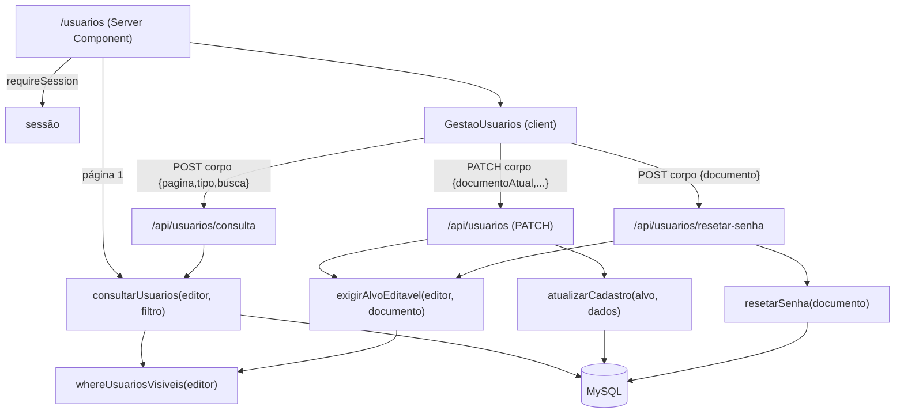

# Gestão de Usuários Design

**Spec**: `.specs/features/gestao-de-usuarios/spec.md`
**Status**: Approved (revisão 2, 2026-10-13: documento fora da URL + paginação no servidor; revisão 3, mesma data: GT sem o AM no escopo e editando todo o escopo)

---

## Architecture Overview

A página `/usuarios` é um Server Component. Ela resolve a sessão, monta os dados do formulário de criação (como hoje) e já renderiza a **página 1** da lista, chamando a mesma função de serviço que a API usa. Daí em diante o componente cliente pede as páginas seguintes, os filtros e as buscas por `POST /api/usuarios/consulta`, com tudo no corpo. Nenhum documento vai para o caminho ou para a query string (GU-48/49, AD-029), e a URL da página nunca muda.

As mutações também levam o alvo no corpo. São elas `PATCH /api/usuarios` (irmão do `POST` de criação, no mesmo arquivo) e `POST /api/usuarios/resetar-senha`. As três rotas reavaliam escopo e matriz a cada request (AD-033) e delegam a um módulo de serviço em `src/lib/usuarios/`. A função de escopo é a mesma para listar e para editar, então "quem vê" e "quem pode mexer" não divergem.



### Approach: como trocar o CPF/CNPJ (a decisão central, AD-045)

`Usuario.documento` é a chave primária, referenciada por 9 FKs em 7 tabelas (6 externas + 2 auto-referências em `TB_Usuario`). **Investigado no banco, não suposto:**

1. Todas as FKs para `TB_Usuario` **já são `ON UPDATE CASCADE`**, porque esse é o default do Prisma, confirmado em `prisma/migrations/*` (`TB_Sessao`, `TB_Avaliacao_Aluno`, `TB_Dado_Pessoal_Aluno`, `TB_Pre_Curso` x2, `TB_Pos_Curso`, `TB_Verba`, `TB_Usuario` x2). `TB_Resposta_Avaliacao` aponta para `TB_Avaliacao_Aluno(CPF, CD_Curso)` também com `ON UPDATE CASCADE`, então segue em cadeia.
2. **O MySQL não cascateia um update de volta para a mesma tabela.** As duas FKs auto-referentes (`TB_Usuario.Criado_Por` e `TB_Usuario.CD_Ofertante`) agem como `RESTRICT`. Provado no `spma-mysql` (8.4), num schema descartável: `UPDATE u SET doc='A2' WHERE doc='A'` com um filho `criado_por='A'` falha com `ERROR 1451`. Sem filho auto-referente, a cascata funciona (a sessão de teste migrou de `A` para `A2`).
3. **Contorno provado no mesmo experimento:** dentro de uma transação, solta os filhos auto-referentes, troca o PK e religa os filhos ao documento novo. Resultado: `A2`/`B2 → A2`, sessão em `A2`.

| Abordagem | Como | Veredito |
| --- | --- | --- |
| **A. Cascata existente + soltar/religar auto-referências** (escolhida) | Transação: guarda quem tem `criadoPor = antigo` e `cdOfertante = antigo`, anula esses campos, faz `usuario.update({ documento: novo })` (as 6 tabelas externas seguem pela FK) e religa os mesmos registros ao novo. | Zero migração; o banco garante as referências externas, inclusive as que forem criadas no futuro. |
| B. Reapontar à mão | Criar a linha nova, mover cada tabela-filha, apagar a antiga. | Enumera 6 tabelas no código; uma FK esquecida vira erro ou órfão. Rejeitada. |
| C. Chave substituta (`id`) | Migrar o PK para um id interno. | Reescreve 9 FKs e contradiz a AD-043. Fora da proporção. Rejeitada. |

### Approach: paginação

| Abordagem | Veredito |
| --- | --- |
| **Offset (`skip`/`take`) + `count`, 20 por página, ordem `nome ↑, documento ↑`** (escolhida) | Suporta "Página X de Y" (GU-14) e combina com filtro e busca. O desempate por `documento` (único) estabiliza a ordem. O custo do offset só pesa com dezenas de milhares de linhas, ordem de grandeza bem acima da base de um programa de qualificação. |
| Cursor (keyset) | Mais barato em bases enormes, mas não dá "Página X de Y" nem salto de página, e complica a combinação com busca. Rejeitada para o volume esperado. |
| Filtro no cliente sobre a lista inteira (design anterior) | Não escala: a resposta cresce com a base. Rejeitada pelo usuário. |

---

## Code Reuse Analysis

### Existing Components to Leverage

| Component | Location | How to Use |
| --- | --- | --- |
| `TIPOS_PERMITIDOS` / `podeCriar` | `src/lib/auth/cascata.ts` | A matriz de edição É a de criação. `podeEditarUsuario` chama `podeCriar`. |
| `resolverEscopoOfertante` | `src/lib/auth/permissoes.ts` | CNPJ do GO para o `where` de escopo. |
| `exigirMutacao`, `comTratamentoDeErro`, `erroHttp`, `corpoValidado` | `src/lib/api/*`, `src/lib/errors/api-error.ts` | Preâmbulo CSRF→sessão, 400 de validação e conversão de erro nas três rotas. |
| `validarCPF` / `validarCNPJ` / `normalizarDocumento` | `src/lib/validation/` | Validação do documento novo conforme o `tipo` do alvo ("CPF inválido"/"CNPJ inválido", as mesmas mensagens de `usuarioSchema`). Normalização do alvo e da busca. |
| `NOME_TIPO_USUARIO` | `src/lib/ui/tipos-usuario.ts` | Rótulo dos chips e da coluna tipo. |
| `NovoUsuarioForm` | `src/app/(protegido)/usuarios/novo/NovoUsuarioForm.tsx` | Move para `usuarios/`, sem mudança de regra. Ganha a prop `aoCriar?: () => void` no lugar do `router.push("/usuarios/novo")` (GU-08). |
| `headerCSRF` | `src/lib/security/csrf-client.ts` | Nas três chamadas do cliente. |
| `Card`, `Button`, `Input`, `Field*` | `src/components/ui/` | Toda a UI nova, só com tokens (AD-039). |
| Padrão de integração | `src/lib/respostas/repositorio.integration.test.ts`, `src/lib/verba/saldo.integration.test.ts` | Serviço chamado direto contra o `spma_test` real. |
| Helpers e2e | `e2e/helpers/db.ts` (`upsertUsuario`, `criarPreCurso`, `criarAvaliacao`…), `e2e/helpers/http.ts` | Fixtures e chamadas de API autenticadas com CSRF. |

### Integration Points

| System | Integration Method |
| --- | --- |
| Navegação | `src/lib/ui/navegacao.ts`: `NOVO_USUARIO` vira `GESTAO_USUARIOS = { rotulo: "Gestão de usuários", href: "/usuarios" }`. `ROTAS_COM_SESSAO` deriva `/usuarios` sozinho. |
| `/usuarios/novo` | `page.tsx` com `redirect("/usuarios")` (`next/navigation`, 307, mesmo padrão de `src/app/page.tsx`; conferido em `node_modules/next/dist/docs/01-app/02-guides/redirecting.md`). |
| Rotas Next | `/api/usuarios/consulta` e `/api/usuarios/resetar-senha` são segmentos estáticos, irmãos de `me/` e `[documento]/`. Segmento estático tem precedência sobre o dinâmico, e `[documento]` só tem o filho `organizacao`. |
| Banco | Nenhuma migração. |
| Login | Nenhuma mudança: o reset deixa `senhaHash = null`, e o PASB-01 já leva ao 1º acesso com a senha em branco. |

---

## Components

### `whereUsuariosVisiveis` - escopo de leitura de usuários

- **Purpose**: o único lugar que define "quem o editor enxerga" (GU-04/05/06).
- **Location**: `src/lib/usuarios/consulta.ts` (junto de quem o executa: a tela e as rotas importam dali)
- **Interfaces**:
  - `whereUsuariosVisiveis(editor: UsuarioComEscopo): Prisma.UsuarioWhereInput | null`
    - AM → `{}`
    - GT → `{ tipo: { not: "AM" } }` (revisão 3: o GT não vê o AM)
    - GO → `{ OR: [ { tipo: "VO", cdOfertante: cnpj }, { tipo: "AL", avaliacoes: { some: { curso: { cdOfertante: cnpj } } } } ] }`, com `cnpj = resolverEscopoOfertante(editor)`
    - VT/VO/AL → `null` (sem acesso)
- **Por que não `escopoDeLeitura`**: aquele dá escopo nacional ao VT e escopo por Ofertante ao VO. Aqui os dois não têm acesso, e o Aluno entra pela matrícula, não por `cdOfertante`.

### `podeEditarUsuario` - matriz de edição

- **Location**: `src/lib/auth/permissoes.ts` (reexportada por `guards.ts`)
- **Interface**: `podeEditarUsuario(editor: { tipo; documento }, alvo: { tipo; documento }): boolean` = nunca a própria conta; GT → `alvo.tipo !== "AM"` (revisão 3: edita todo o seu escopo); AM e GO → `podeCriar(editor.tipo, alvo.tipo)`
- **Nota (JSDoc)**: o escopo não entra aqui. Quem chama só tem o alvo em mãos se ele saiu de uma consulta escopada (`consultarUsuarios` / `buscarUsuarioVisivel`).

### Paginação e chips (puros)

- **Location**: `src/lib/usuarios/paginacao.ts`
- **Interfaces**:
  - `TAMANHO_PAGINA = 20`
  - `totalPaginas(total: number): number` = `Math.max(1, Math.ceil(total / TAMANHO_PAGINA))`
  - `tiposVisiveis(tipo: TipoUsuario): TipoUsuario[]`: AM → os 6 (ordem do enum); GT → os 5 sem o AM (revisão 3); GO → `[VO, AL]`; demais → `[]` (GU-09)

### Schemas das três rotas

- **Location**: `src/lib/validation/schemas/gestao-usuario.schema.ts`
- **Interfaces** (todos `.strict()`, então uma chave desconhecida dá 400: GU-17, GU-30, GU-44, GU-47):
  - `consultaUsuariosSchema`: `{ pagina: z.number().int().min(1), tipo?: z.enum(TipoUsuario), busca?: z.string().trim().max(100) }`
  - `edicaoUsuarioSchema`: `{ documentoAtual: z.string().min(1), nome?: z.string().trim().min(1, "Nome é obrigatório").max(255), email?: z.union([z.string().email("Email inválido"), z.literal("")]), documentoNovo?: z.string().min(1) }` + `refine` (ao menos um de `nome`/`email`/`documentoNovo`, "Nada para alterar") + `transform` (`documentoAtual` → só dígitos; `email: "" → null`)
  - `resetarSenhaSchema`: `{ documento: z.string().min(1) }` → só dígitos

### Consulta - `src/lib/usuarios/consulta.ts`

```typescript
type UsuarioListado = { documento: string; nome: string | null; email: string | null; tipo: TipoUsuario };
type LinhaGestao = UsuarioListado & { editavel: boolean };
type PaginaUsuarios = { usuarios: LinhaGestao[]; total: number; pagina: number; totalPaginas: number };
```

- `consultarUsuarios(editor, { pagina, tipo?, busca? }): Promise<PaginaUsuarios>`, para um editor com `whereUsuariosVisiveis !== null`:
  - `where = { AND: [escopo, tipo ? { tipo } : {}, whereDaBusca(busca)] }`
  - `whereDaBusca`: vazio → `{}`; senão `{ OR: [ { nome: { contains: busca } }, ...(digitos ? [{ documento: { contains: digitos } }] : []) ] }`, com `digitos = normalizarDocumento(busca)`. A collation default do MySQL 8.4 (`utf8mb4_0900_ai_ci`) já faz o `contains` sem diferenciar maiúsculas. O teste de integração prova isso, e não a suposição.
  - `prisma.$transaction([count({ where }), findMany({ where, select 4 colunas, orderBy: [{ nome: "asc" }, { documento: "asc" }], skip: (pagina-1)*20, take: 20 })])`
  - `editavel = podeEditarUsuario(editor, linha)`
- `buscarUsuarioVisivel(editor, documento): Promise<UsuarioListado | null>`: `findFirst({ where: { AND: [{ documento }, escopo] } })`.
- `exigirAlvoEditavel(editor, documento): Promise<UsuarioListado>`: `null` → 404 "Usuário não encontrado" só para o AM (único que vê todos; revisão 3), 403 "Você não tem permissão para editar este usuário" para os demais; `!podeEditarUsuario` → 403, mesma mensagem.

### Serviço de escrita - `src/lib/usuarios/gestao.ts`

- `validarDocumentoDoTipo(tipo, valor): string`: normaliza e valida, ou lança 400 "CPF inválido"/"CNPJ inválido".
- `atualizarCadastro(alvo: UsuarioListado, dados): Promise<UsuarioListado>`:
  - Sem `documentoNovo`, ou com ele igual ao atual (GU-39): `usuario.update({ nome, email })` e mais nada.
  - Com documento novo: checagem prévia `findUnique(novo)` → 409 "Documento já cadastrado"; depois `prisma.$transaction(async tx => …)`:
    1. guarda `criados` (`criadoPor = antigo`) e `vinculados` (`cdOfertante = antigo`)
    2. anula `criadoPor` e `cdOfertante` desses registros
    3. `tx.usuario.update({ where: { documento: antigo }, data: { documento: novo, nome?, email? } })`: o banco cascateia para as 6 tabelas externas
    4. religa `criados → criadoPor: novo` e `vinculados → cdOfertante: novo`
    5. `tx.sessao.deleteMany({ where: { cpfUsuario: novo } })` (GU-34)
  - `P2002` dentro da transação → `erroHttp(409, "Documento já cadastrado")`, com rollback (GU-36, a corrida).
- `resetarSenha(documento): Promise<void>`: `$transaction([ usuario.update({ senhaHash: null, primeiraVez: true, tentativasFalhas: 0, bloqueadoAte: null }), sessao.deleteMany({ cpfUsuario: documento }) ])`.

### Rotas

| Rota | Arquivo | Fluxo | Resposta |
| --- | --- | --- | --- |
| `POST /api/usuarios/consulta` | `src/app/api/usuarios/consulta/route.ts` | `exigirMutacao` → `corpoValidado(consultaUsuariosSchema)` → `whereUsuariosVisiveis === null` → 403 "Acesso negado" → `consultarUsuarios` | `200 PaginaUsuarios` |
| `PATCH /api/usuarios` | `src/app/api/usuarios/route.ts` (junto do `POST`) | `exigirMutacao` → `corpoValidado(edicaoUsuarioSchema)` → `exigirAlvoEditavel(documentoAtual)` → `validarDocumentoDoTipo` (se veio) → `atualizarCadastro` | `200 { usuario }` |
| `POST /api/usuarios/resetar-senha` | `src/app/api/usuarios/resetar-senha/route.ts` | `exigirMutacao` → `corpoValidado(resetarSenhaSchema)` → `exigirAlvoEditavel` → `resetarSenha` | `200 { ok: true }` |

A forma é validada antes de buscar o alvo, como nas demais rotas: um 400 de forma não revela nada sobre o alvo.

### Tela

- **`src/app/(protegido)/usuarios/page.tsx`** (Server Component): `requireSession` → dados do formulário (lógica atual de `novo/page.tsx`, movida) → se `whereUsuariosVisiveis(usuario)` não é nulo, `consultarUsuarios(usuario, { pagina: 1 })` → `<GestaoUsuarios formulario={…} paginaInicial={…} tipos={tiposVisiveis(usuario.tipo)} />`. Para VT/VO/AL, `paginaInicial = null` e nenhuma lista (GU-06).
- **`src/app/(protegido)/usuarios/novo/page.tsx`**: só `redirect("/usuarios")`.
- **`GestaoUsuarios.tsx`** (`"use client"`): renderiza o `Card` do `NovoUsuarioForm` (com `aoCriar={recarregar}`) e a lista. Estado: `filtro { pagina, tipo, busca }`, `resultado: PaginaUsuarios`, `editando: string | null`, `carregando`. `recarregar()` faz `POST /api/usuarios/consulta` com o filtro atual. Trocar chip ou busca zera a página para 1 (GU-15); a busca espera 300 ms sem digitação antes de consultar. Abaixo da lista: "Anterior", "Página X de Y", "Próxima" (GU-14). Nada vai para a URL (GU-49).
- **`LinhaUsuario.tsx`** (`"use client"`): modo leitura (nome, documento, `NOME_TIPO_USUARIO[tipo]`, e-mail, botão "Editar" se `editavel`). No modo edição: nome, e-mail e documento (rótulo e `maxLength` conforme o tipo, só dígitos: GU-40), "Salvar", "Cancelar" e "Resetar senha", que abre a confirmação inline "Confirmar reset"/"Cancelar" (GU-45) e depois a mensagem de GU-46. Salvar com sucesso chama `aoSalvar` (o `recarregar` do pai, GU-31); um erro fica na linha.

---

## Error Handling Strategy

| Error Scenario | Handling | User Impact |
| --- | --- | --- |
| Sem CSRF / sem sessão | `exigirMutacao` → 403 / 401 | Mensagem genérica na linha ou na lista |
| Corpo fora do schema (chave extra, página inválida, busca > 100, nome/e-mail inválidos, nada para alterar) | `.strict()` + `corpoValidado` → 400 com a 1ª issue | Mensagem na linha |
| Documento novo inválido para o tipo | `validarDocumentoDoTipo` → 400 | Idem |
| VT/VO/AL consultando | 403 "Acesso negado" | Não acontece pela tela (sem lista) |
| Alvo fora do escopo, fora da matriz ou o próprio editor | `exigirAlvoEditavel` → 403 | Não acontece pela tela (sem botão) |
| Alvo inexistente | 404 para o AM, 403 para GT e GO (revisão 3) | Idem |
| Documento novo já existe | Checagem prévia → 409; `P2002` na transação → 409 | "Documento já cadastrado" na linha |
| Falha no meio da troca | `$transaction` desfaz tudo → 500 genérico de `comTratamentoDeErro` | Nada parcialmente trocado |
| Falha de rede na consulta | O cliente mantém a última página exibida e mostra "Não foi possível carregar os usuários" | Lista anterior continua visível |

---

## Risks & Concerns

| Concern | Location (file:line) | Impact | Mitigation |
| --- | --- | --- | --- |
| Auto-referência bloqueia a cascata (`ERROR 1451`) | `prisma/schema.prisma:64`, `:92` | Trocar o documento de um criador ou de um GO com VOs daria 500 | Soltar/religar na transação (AD-045). Teste de integração com criador + GO com VO. |
| Corrida: alguém vincula um VO ao GO antigo durante a troca | `atualizarCadastro` | `1451` no passo 3 → 500 com rollback | Janela de milissegundos numa operação rara: termina em rollback, sem corrupção. Sem `SELECT … FOR UPDATE`. |
| Integração de consulta no banco compartilhado `spma_test` | `consulta.integration.test.ts` | Para AM/GT o escopo é "todos", e linhas de outros arquivos de teste entram na contagem | Fixtures com prefixo único no nome (`"GU-T "`) e asserções sempre com `busca: "GU-T"`. A contagem exata fica isolada. `fileParallelism: false` já evita concorrência. |
| Offset em bases muito grandes | `consultarUsuarios` | Página alta fica mais lenta | Índice em `tipo` já existe. Keyset fica como evolução se a base passar de dezenas de milhares (registrado nas abordagens). |
| `contains` com `%…%` não usa índice | `whereDaBusca` | Varredura da tabela a cada busca | Aceitável no volume esperado, com busca limitada a 100 caracteres e debounce de 300 ms. |
| URLs de documento já existentes | `/avaliacoes/[cpf]/…`, `/api/usuarios/[documento]/organizacao` | Contrariam o espírito de GU-48 fora desta feature | Fora de escopo (spec). Esta feature não cria URL nova com documento. |
| e2e que navegam para `/usuarios/novo` ou conferem o href do menu | `e2e/usuarios-novo-page.spec.ts`, `proxy.spec.ts`, `identidade-visual.spec.ts`, `organizacao.spec.ts`, `src/lib/ui/navegacao.test.ts` | Asserções de href quebram | O redirect mantém a navegação. Ajustar só o que quebrar. |
| Regra "alvo no escopo" fora de `podeEditarUsuario` | `permissoes.ts` | Um chamador futuro que monte o alvo à mão pularia o escopo | JSDoc explícito; as duas mutações passam por `exigirAlvoEditavel`, coberto em integração. |

---

## Test Strategy (camada mais barata que prova o AC)

Convenção do repositório: rotas de API são provadas por e2e, sem um `*.integration.test.ts` por rota. A lógica com banco é provada em integração **na camada de serviço**, que é barata e usa banco real. Assim o e2e das rotas só prova a ligação (CSRF, status, contrato).

| Camada | O que prova | ACs |
| --- | --- | --- |
| Unit | `podeEditarUsuario` (matriz completa + auto-edição), `tiposVisiveis`, `totalPaginas`, os três schemas, `navegacao` | GU-01, GU-09, GU-17, GU-21, GU-25, GU-26, GU-30, GU-44, GU-47 |
| Integração | `consultarUsuarios`: escopo GO/GT, tipo, busca por nome (maiúsculas) e documento (com pontuação), 25 → 20 + 5, desempate, página além do fim | GU-04, GU-05, GU-10, GU-11, GU-13, GU-16, GU-18 |
| Integração | `exigirAlvoEditavel`: 403 fora do escopo, fora da matriz e auto-edição; 404 AM x 403 GT/GO para inexistente | GU-27, GU-28, GU-43 |
| Integração | `atualizarCadastro` / `resetarSenha`: cada tabela no doc novo e zero no antigo (L-014: todo conjunto), sessões apagadas, campos preservados, 409 prévio, mesmo documento, reset completo | GU-24, GU-32–GU-39, GU-41, GU-42 |
| e2e API (`e2e/usuarios-gestao.spec.ts`) | Ligação das três rotas: 200 do contrato, 403 sem CSRF, 403 VT na consulta, 400 de chave extra, documento só no corpo | GU-16, GU-19, GU-20, GU-29, GU-44, GU-48 |
| e2e UI (`e2e/usuarios-page.spec.ts`, substitui `usuarios-novo-page.spec.ts`) | Redirect; criar → aparece na lista; chips; busca; "Página X de Y"; editar inline + erro na linha; reset com confirmação; sem "Editar" em linha só-leitura; URL sem query | GU-02, GU-03, GU-06–GU-08, GU-12, GU-14, GU-15, GU-22, GU-23, GU-31, GU-40, GU-45, GU-46, GU-49 |

---

## Tech Decisions

| Decision | Choice | Rationale |
| --- | --- | --- |
| Troca de PK | Cascata existente + soltar/religar (AD-045) | Provado no MySQL 8.4; zero migração. |
| Paginação | Offset + count, 20 fixos, `nome, documento` | "Página X de Y", estável, simples; volume esperado longe do limite do offset. |
| Documento fora da URL | Consulta por `POST` com corpo; mutações com alvo no corpo | GU-48 / AD-029: a busca pode ser um CPF, então nem a leitura usa query string. |
| Página 1 renderizada no servidor | `page.tsx` chama `consultarUsuarios` direto | Sem "piscar" vazio no primeiro carregamento; mesma função da API, sem duplicar regra. |
| Escopo de usuários | Função nova `whereUsuariosVisiveis` | As regras divergem de `escopoDeLeitura`. |
