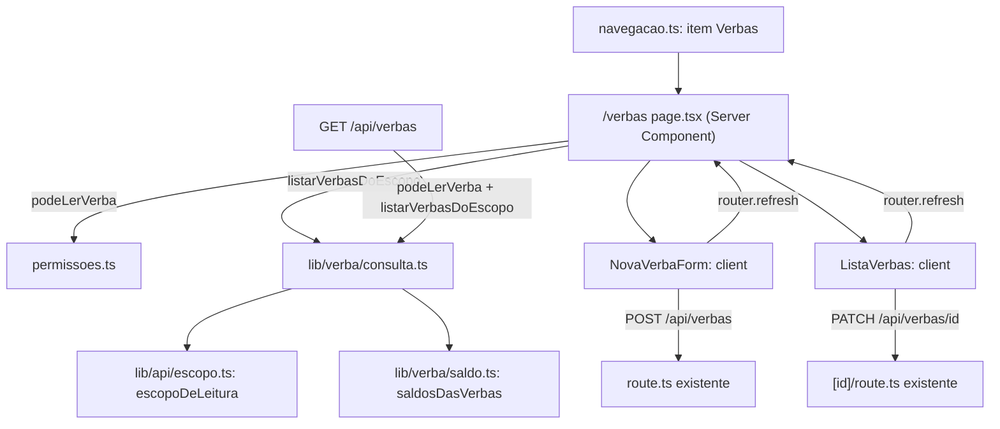

# Gestão de Verbas Design

**Spec**: `.specs/features/gestao-de-verbas/spec.md`
**Context**: `.specs/features/gestao-de-verbas/context.md`
**Status**: Approved (usuário pediu "prossiga para o design e implementação", 2026-10-13)

---

## Architecture Overview

Nenhuma tabela nova e nenhuma migração: `Verba.cdOfertante → Usuario.documento` já é 1:N. A feature é uma tela nova sobre a API que já existe, mais três mudanças de contrato:

1. `POST /api/usuarios` deixa de aceitar e de criar verba.
2. `GET /api/verbas` e `GET /api/verbas/[id]` passam a negar leitura ao VT.
3. `verba.schema` ganha teto, limite de casas decimais e mensagens para campo ausente.



### Approach

**Escolhido:** Server Component carrega a lista por uma função de lib compartilhada com `GET /api/verbas`. Depois de criar ou editar, o cliente chama `router.refresh()`. É o padrão de `/usuarios`, onde a página 1 sai da mesma `consultarUsuarios` que a API usa, então tela e API não divergem. O `router.refresh()` é o mesmo mecanismo que `NovoUsuarioForm` já usa depois de criar.

**Descartado:** página cliente que busca `GET /api/verbas` no `useEffect`. A tela abriria vazia e piscaria, e o refetch de `/usuarios` só existe por causa de filtros e paginação, que esta tela não tem (Out of Scope).

---

## Code Reuse Analysis

### Existing Components to Leverage

| Component | Location | How to Use |
| --- | --- | --- |
| `escopoDeLeitura` / `whereDeEscopo` | `src/lib/api/escopo.ts` | Decide o escopo da lista (todos, ou o GO) na lib nova, como `GET /api/verbas` já faz |
| `saldosDasVerbas` | `src/lib/verba/saldo.ts:39` | Saldo da lista inteira num `groupBy` só (REQ-OV-11), sem N+1 |
| `podeGerenciarVerba` | `src/lib/auth/permissoes.ts:110` | Decide se a página mostra o formulário e a ação de editar (AM/GT) |
| `POST /api/verbas` | `src/app/api/verbas/route.ts` | Criação, sem alteração de regra: guard AM/GT, GO existente, 201 |
| `PATCH /api/verbas/[id]` | `src/app/api/verbas/[id]/route.ts` | Edição, sem alteração de regra: 409 abaixo do alocado (AD-016) |
| `corpoValidado` | `src/lib/api/requisicao.ts` | Já converte falha do Zod em 400. O teto novo do schema vira 400 sem tocar nas rotas |
| `GestaoUsuarios` / `LinhaUsuario` | `src/app/(protegido)/usuarios/` | Padrão visual: card do formulário acima, card da lista, edição dentro da linha, uma linha aberta por vez |
| `<select>` nativo de GOs | `NovoUsuarioForm.tsx:220-235` | Mesma marcação e classes para o seletor de GO |
| `headerCSRF` | `src/lib/security/csrf-client.ts` | Cabeçalho CSRF das mutações |
| Estado vazio de `/cursos/novo` | `NovoCursoForm.tsx:74` | GV-25 já está implementado e testado em `e2e/cursos-novo.spec.ts:150-154`; nada a mudar |

### Integration Points

| System | Integration Method |
| --- | --- |
| Navegação | Item `VERBAS` em `MODULOS_POR_PERFIL`. `ROTAS_COM_SESSAO` é derivada, então `/verbas` passa a exigir sessão no proxy sem lista à mão (GV-30) |
| Layout `(protegido)` | `requireSession` + gates de onboarding já valem para `/verbas` por estar dentro do grupo |
| `POST /api/usuarios` | Remove o bloco de verba e o `exigeOfertanteEVerba`; `usuarioSchema` passa a rejeitar `verba` |

---

## Components

### `verba.schema.ts` (modificado)

- **Purpose**: Ser a autoridade da forma do valor da verba na criação e na edição.
- **Location**: `src/lib/validation/schemas/verba.schema.ts`
- **Interfaces**:
  - `camposVerbaSchema`: `vlVerba` com quatro mensagens: ausente → "Valor da verba é obrigatório"; `<= 0` → "Valor da verba deve ser positivo"; `> 99999999.99` → "Valor da verba excede o máximo permitido"; mais de 2 casas → "Valor da verba aceita no máximo 2 casas decimais".
  - `verbaSchema`: `cdOfertante` ausente ou vazio → "Ofertante é obrigatório".
- **Reuses**: o próprio schema. `edicaoVerbaSchema = camposVerbaSchema` herda o teto (GV-21).
- **Nota**: a checagem de casas decimais compara `valor * 100` com o inteiro mais próximo, com tolerância de `1e-6`. `0.29 * 100` dá `28.999999999999996` em ponto flutuante, e uma checagem exata rejeitaria um valor válido.

### `podeLerVerba` (novo)

- **Purpose**: Guarda de LEITURA de verba por tipo: AM, GT, GO e VO podem; VT e AL não.
- **Location**: `src/lib/auth/permissoes.ts`, reexportada por `src/lib/auth/guards.ts`
- **Interfaces**: `podeLerVerba(tipo: TipoUsuario): boolean`
- **Reuses**: nada. É deliberadamente separada de `podeAcessarOfertante`, que continua `true` para o VT porque guarda a leitura de cursos, onde o alcance nacional do VT segue valendo.

### `listarVerbasDoEscopo` (novo)

- **Purpose**: Lista as verbas que o usuário pode ver, com o nome do GO e o saldo disponível, num formato só, para a tela e para `GET /api/verbas`.
- **Location**: `src/lib/verba/consulta.ts`
- **Interfaces**:
  - `listarVerbasDoEscopo(usuario: UsuarioEscopo, cdOfertanteFiltro?: string | null): Promise<VerbaListada[]>`
- **Dependencies**: `prisma`, `escopoDeLeitura`, `whereDeEscopo`, `saldosDasVerbas`
- **Contrato**: o chamador garante `podeLerVerba` antes. Se chegar um AL mesmo assim, o resultado é lista vazia (filtro impossível), nunca a lista inteira: falha fechada.

### `GET /api/verbas` e `GET /api/verbas/[id]` (modificados)

- **Purpose**: Negar 403 a VT e AL (GV-34). A lista passa a vir de `listarVerbasDoEscopo`.
- **Location**: `src/app/api/verbas/route.ts`, `src/app/api/verbas/[id]/route.ts`
- **Contrato HTTP**: cada item de `GET /api/verbas` ganha o campo aditivo `nomeOfertante`. Os demais campos continuam iguais (`cdVerba`, `cdOfertante`, `vlVerba`, `dtVerba`, `dataCriacao`, `saldoDisponivel`). `GET /api/verbas/[id]` não muda de forma.

### `POST /api/usuarios` + `usuarioSchema` (modificados)

- **Purpose**: O GO nasce sem verba (GV-24), e um payload com `verba` é erro de quem chama (GV-26).
- **Location**: `src/lib/validation/schemas/usuario.schema.ts`, `src/app/api/usuarios/route.ts`
- **Mudanças**:
  - `verba` sai do `z.object` como `camposVerbaSchema` e entra em `CAMPOS_NUNCA_NA_CRIACAO` (declarado como `z.unknown().optional()`, para o Zod não descartá-lo em silêncio). A mensagem é "verba não é aceito na criação de usuário", mesmo padrão dos outros campos da lista.
  - Saem da rota: o 403 "Você não tem permissão para criar verba", o 400 "Gestor Ofertante exige um Ofertante e o valor da verba" e o `tx.verba.create`. A resposta 201 deixa de ter a chave `verba`.
  - `exigeOfertanteEVerba` fica órfã e sai de `permissoes.ts`, de `guards.ts` e de `guards.test.ts`.

### `NovoUsuarioForm.tsx` (modificado)

- **Purpose**: Tirar os campos "Valor da verba" e "Data da verba" (GV-23).
- **Location**: `src/app/(protegido)/usuarios/NovoUsuarioForm.tsx`
- **Mudanças**: remove `vlVerba`/`dtVerba`/`pedeVerba` e o `verba` do payload. O seletor de GO para VO (`pedeGoParaVo`) continua.

### `/verbas` — `page.tsx` (novo, Server Component)

- **Purpose**: Montar a tela conforme o perfil.
- **Location**: `src/app/(protegido)/verbas/page.tsx`
- **Comportamento**:
  - `!podeLerVerba(tipo)` → card "Verbas" com "Seu perfil não tem acesso a verbas." (GV-17). Nenhuma consulta de verba roda.
  - `podeGerenciarVerba(tipo)` → carrega os GOs (`documento`, `nome`, ordem por nome) e renderiza `NovaVerbaForm`.
  - Sempre renderiza `ListaVerbas` com `podeEditar = podeGerenciarVerba(tipo)`.
- **Serialização**: `Decimal → number` e `Date → "AAAA-MM-DD"` (UTC) antes de passar ao cliente.

### `NovaVerbaForm.tsx` (novo, client)

- **Purpose**: Criar uma verba para um GO (GV-01..05, 07, 09, 10).
- **Location**: `src/app/(protegido)/verbas/NovaVerbaForm.tsx`
- **Props**: `gos: { documento: string; nome: string | null }[]`
- **Comportamento**: `<select id="cdOfertante">` com rótulo "GO" e opções "Nome — CNPJ" (só o CNPJ sem nome); `Input` de valor (`id="vlVerba"`, rótulo "Valor da verba") e de data (`id="dtVerba"`, rótulo "Data de liberação"). A validação no cliente é `verbaSchema.safeParse`, mostrando a primeira mensagem; o servidor revalida. O botão "Criar verba" fica desabilitado enquanto envia ou quando `gos` está vazio. Sem GO cadastrado, mostra "Nenhum Ofertante cadastrado - cadastre um GO antes de criar uma verba.". Com 201: limpa os campos e chama `router.refresh()`. Erro da API: mostra `corpo.erro`.

### `ListaVerbas.tsx` (novo, client)

- **Purpose**: Listar as verbas e, para AM/GT, editar valor e data na própria linha (GV-11, 14, 15, 18..20, 22).
- **Location**: `src/app/(protegido)/verbas/ListaVerbas.tsx`
- **Props**: `verbas: VerbaDaTela[]`, `podeEditar: boolean`
- **Comportamento**: `<ul>` com um `<li data-testid="verba-{cd}">` por verba, contendo o nome do GO, o CNPJ, "Valor R$ x.xx", "Saldo R$ x.xx" e a data (`dd/mm/aaaa` ou "—"). Lista vazia mostra "Nenhuma verba cadastrada.". Com `podeEditar`, cada linha tem um botão "Editar", e uma linha abre por vez. A edição mostra só os campos de valor e data (nunca o GO, GV-22) e envia `PATCH` com `{ vlVerba, dtVerba? }`. Com sucesso, fecha e chama `router.refresh()`; com erro, mostra `corpo.erro` e a linha continua aberta. A formatação de moeda segue a de `NovoCursoForm`: `R$ ${valor.toFixed(2)}`.

### `navegacao.ts` (modificado)

- **Purpose**: Dar ao item "Verbas" o lugar dele no menu (GV-27..29).
- **Location**: `src/lib/ui/navegacao.ts`
- **Mudanças**: `const VERBAS = { rotulo: "Verbas", href: "/verbas" }`. AM/GT: o módulo "Verbas" ganha `itens: [VERBAS]`. GO: `[Gestão de usuários, Verbas, Meus cursos]`. VO: `[Verbas, Meus cursos]`. VT e AL não mudam. Ordem no cabeçalho do AM: Painel, Gestão de usuários, Verbas, Novo curso, Pré-cursos, Pós-cursos, Avaliações.

---

## Data Models

Sem mudança no schema Prisma. Tipos novos, só de aplicação:

```typescript
// src/lib/verba/consulta.ts
interface VerbaListada {
  cdVerba: number;
  cdOfertante: string;          // CNPJ do GO
  nomeOfertante: string | null; // Usuario.nome do GO
  vlVerba: Prisma.Decimal;
  dtVerba: Date | null;
  dataCriacao: Date;
  saldoDisponivel: Prisma.Decimal; // vlVerba - soma(vlCursoAlocado)
}

// src/app/(protegido)/verbas/ListaVerbas.tsx (props serializáveis)
interface VerbaDaTela {
  cdVerba: number;
  cdOfertante: string;
  nomeOfertante: string | null;
  vlVerba: number;
  saldoDisponivel: number;
  dtVerba: string | null; // "AAAA-MM-DD"
}
```

**Relationships**: Verba N → 1 Usuario (GO). Inalterada.

---

## Error Handling Strategy

| Error Scenario | Handling | User Impact |
| --- | --- | --- |
| Formulário sem GO / sem valor / valor `<= 0` | `verbaSchema.safeParse` no cliente; nada é enviado | Mensagem do schema sob o formulário |
| Valor acima do teto ou com 3+ casas | Mesmo schema no cliente; no servidor, `corpoValidado` → 400 | Mensagem do schema, nada criado |
| GO informado não existe (API direta) | 400 existente "Ofertante informado não existe" | Mensagem da API sob o formulário |
| Perfil sem permissão de escrita (API direta) | 403 existente (`podeGerenciarVerba`) | Não alcançável pela tela: o formulário não aparece |
| VT/AL lendo verba pela API | 403 novo (`podeLerVerba`) | — |
| VT/AL abrindo `/verbas` | Card com "Seu perfil não tem acesso a verbas." | Mensagem, sem dados |
| Edição abaixo do alocado | 409 existente, mensagem da API | Mensagem na linha, que continua aberta; valor não muda |
| Falha de rede no envio | `try/finally` reabilita o botão | Mensagem "Não foi possível criar a verba" ou "Não foi possível salvar a verba" |
| `POST /api/usuarios` com `verba` | 400 do `usuarioSchema` antes de qualquer escrita | Só cliente desatualizado ou API direta |

---

## Risks & Concerns

| Concern | Location (file:line) | Impact | Mitigation |
| --- | --- | --- | --- |
| Testes que codificam o comportamento antigo (GO nasce com verba) | `e2e/usuarios.spec.ts:405-505`, `e2e/usuarios-page.spec.ts:135-178`, `src/lib/validation/schemas/usuario.schema.test.ts:188-237`, `src/lib/auth/guards.test.ts:580-600` | Ficam vermelhos com a mudança aprovada | Reescritos para o comportamento novo nas tarefas que mudam o contrato (T5, T6), com o motivo no corpo do commit. Mesmo precedente da T25 de `unificacao-ofertante-go`. Nenhum é apagado sem um substituto que prove o comportamento novo |
| `podeAcessarOfertante` devolve `true` para VT e é usada por várias rotas de leitura | `src/lib/auth/permissoes.ts:64-79` | Mudá-la tiraria do VT a leitura de cursos | Não mudar. Guarda nova e dedicada (`podeLerVerba`) só nas rotas de verba |
| Valor acima de `DECIMAL(10,2)` hoje vira 500 | `src/lib/validation/schemas/verba.schema.ts:8` | A tela nova expõe o campo a digitação livre | Teto no schema (T1), compartilhado por POST e PATCH |
| Corrida entre editar o valor e alocar um curso | `src/app/api/verbas/[id]/route.ts:53`, `src/app/api/cursos/route.ts:38` | Anterior à feature: duas checagens de saldo sem lock | Registrado em Assumptions do spec. Fora do escopo |
| `exigeOfertanteEVerba` fica sem uso | `src/lib/auth/permissoes.ts:191-202` | Código morto | Removida junto, na mesma tarefa que a orfana (T5) |
| GV-10 (nenhum GO) não é determinístico em e2e: os specs rodam em paralelo e criam GOs | — | Sem teste de tela possível pelo navegador | Teste unitário que renderiza `NovaVerbaForm` com `gos=[]` via `react-dom/server` `renderToStaticMarkup`, em `.test.ts` com `createElement` (o runner só pega `*.test.ts`) |

---

## Tech Decisions

| Decision | Choice | Rationale |
| --- | --- | --- |
| Onde mora a lista com escopo e saldo | `src/lib/verba/consulta.ts`, consumida pela página e por `GET /api/verbas` | Mesmo raciocínio de `consultarUsuarios`: tela e API não divergem |
| Atualização após criar/editar | `router.refresh()` | Re-renderiza o Server Component com dados novos, sem fetch manual nem estado duplicado |
| Seletor de GO | `<select>` nativo | Mesmo controle do seletor de GO de `NovoUsuarioForm`; dá para usar `selectOption` direto no Playwright |
| Bloqueio do VT | Guarda nova `podeLerVerba`, não alteração de `podeAcessarOfertante` | Isola a mudança às rotas de verba |
| Moeda | `R$ ${n.toFixed(2)}`, como em `NovoCursoForm` | Sem formatador novo para um uso só |

**Project-level:** AD-046 registrada em `.specs/STATE.md`. Ela supera a parte de REQ-OV-08 que cria a verba junto do GO e restringe REQ-OV-10 para o VT.
