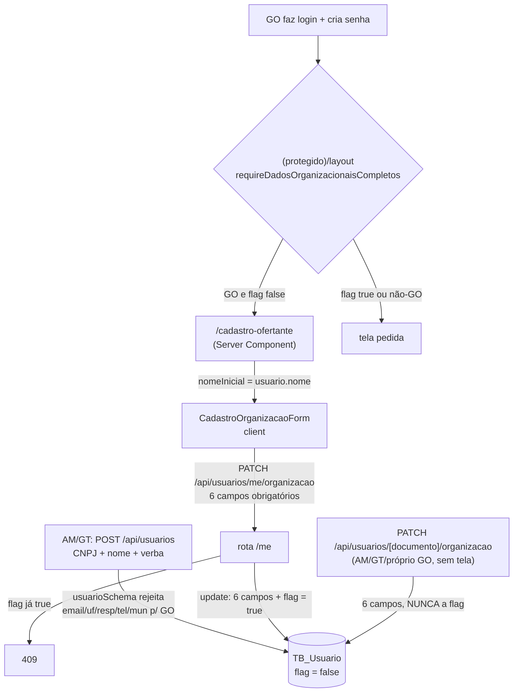

# Onboarding Organizacional do GO Design

**Spec**: `.specs/features/onboarding-organizacional-go/spec.md`
**Status**: Approved (usuário autorizou Design + Execute em 2026-10-12: "pode prosseguir para o design e implementação")

---

## Architecture Overview

Nenhum componente novo de arquitetura: o formulário, o endpoint e o gate já existem desde `unificacao-ofertante-go` (UGO-01). A feature troca **o critério de completude** — de "campos não-nulos" para uma flag persistida, no mesmo desenho da AD-042 — e muda **quem escreve o quê**: a criação perde os 5 campos organizacionais, o onboarding passa a exigir os 6.

**Exploração de abordagens (Large):** decidida com o usuário antes do Design, em `context.md` decisão 1. As duas candidatas eram (A) flag persistida `dadosOrganizacionaisCompletos` e (B) continuar deduzindo completude por campos nulos, fazendo a criação parar de enviar `uf`. Escolhida A: (B) acopla o gate ao que a criação manda, e quebra em silêncio no dia em que alguém voltar a aceitar `uf` na criação. A não é reaberta aqui.



---

## Code Reuse Analysis

### Existing Components to Leverage

| Component | Location | How to Use |
| --- | --- | --- |
| Gate de flag persistida | `src/lib/auth/guards.ts` `requireDadosPessoaisCompletos` | Mesma forma para o guard renomeado: `(usuario: {tipo, flag}) => void`, redirect só para o tipo afetado. |
| Coluna de flag com default | `prisma/migrations/20260911194429_*/migration.sql` | Mesmo `ADD COLUMN ... BOOLEAN NOT NULL DEFAULT false`. O default é o que entrega OGO-14 e OGO-16 sem `UPDATE`. |
| Página Server → formulário Client | `src/app/(protegido)/meus-dados/page.tsx` + `src/components/dados-pessoais/DadosPessoaisForm.tsx` | `/cadastro-ofertante` vira Server Component que lê a sessão e passa `nomeInicial` a um client component em `src/components/organizacao/`. |
| Fixture com default `true` para flag de gate | `scripts/e2e-fixture.ts` `upsertUsuario` (`dadosPessoaisCompletos ?? true`) | Mesmo tratamento para a flag nova — ver Risks #1. |
| Teste de migration contra o artefato real | `src/lib/respostas/dados-pessoais-migracao.integration.test.ts` | Ler `migration.sql` e executá-lo em `spma_test`, não reimplementar o SQL. |
| `dadosOrganizacao()` / `CAMPOS_ORGANIZACAO` | `src/lib/validation/schemas/organizacao-dados.ts` | Continua sendo o mapeamento compartilhado pelas duas rotas de organização. A flag fica **fora** dele (ver Tech Decisions). |
| `corpoValidado` → 400 com a primeira issue | `src/lib/api/requisicao.ts:28-44` | Toda rejeição nova (OGO-04, OGO-10) é issue de Zod; nenhum `if` de validação à mão nas rotas. |

### Integration Points

| System | Integration Method |
| --- | --- |
| Sessão | `obterSessao` usa `include: { usuario: true }` (`src/lib/auth/session.ts:62`) — a coluna nova chega aos guards e à página sem mudar select. |
| Cadeia de guards | `(protegido)/layout.tsx:36-39`: só o nome da 3ª chamada muda; a ordem (sessão → senha → organização → dados pessoais) entrega OGO-08. |
| `prisma generate` | Cliente gerado em `src/generated/prisma` — regenerar após o schema. `npm run build` já roda `prisma generate`. |
| `db:test:reset` | Aplica migrations pendentes via `prisma migrate deploy` antes de cada rodada de integração/e2e — a migration nova entra sozinha. |

---

## Components

### 1. Coluna `Usuario.dadosOrganizacionaisCompletos`

- **Purpose**: Registrar que o próprio GO declarou os dados organizacionais.
- **Location**: `prisma/schema.prisma` (model `Usuario`), `prisma/migrations/20261012120000_onboarding_organizacional_go/migration.sql`
- **Interfaces**: `dadosOrganizacionaisCompletos Boolean @default(false) @map("Dados_Organizacionais_Completos")`
- **Dependencies**: nenhuma.
- **Reuses**: forma de `dadosPessoaisCompletos`.

### 2. Guard `requireDadosOrganizacionaisCompletos`

- **Purpose**: Barrar GO com a flag `false` em toda tela de `(protegido)`.
- **Location**: `src/lib/auth/guards.ts` (substitui `requireOfertanteVinculado`), chamada em `src/app/(protegido)/layout.tsx`.
- **Interfaces**: `requireDadosOrganizacionaisCompletos(usuario: { tipo: TipoUsuario; dadosOrganizacionaisCompletos: boolean }): void` — `redirect("/cadastro-ofertante")` sse `tipo === "GO" && !dadosOrganizacionaisCompletos`.
- **Dependencies**: `next/navigation`.
- **Reuses**: `requireDadosPessoaisCompletos`.
- **Renomeado porque** o nome antigo já mentia desde a AD-043 (não existe mais "vínculo" com Ofertante a checar) e agora não olha nem `nome` nem `uf`.

### 3. `organizacaoSchema` com os 6 obrigatórios

- **Purpose**: Contrato único de "dados organizacionais válidos", para as duas rotas de organização.
- **Location**: `src/lib/validation/schemas/organizacao.schema.ts`
- **Interfaces** (mensagem por campo, igual para ausente e vazio):
  - `nome`, `responsavel`, `telefone`, `municipio`: `z.string({ message: "<Campo> é obrigatório" }).min(1, { message: "<Campo> é obrigatório" })`
  - `email`: `z.string({ message: "Email é obrigatório" }).email({ message: "Email inválido" })`
  - `uf`: `z.enum(OPCOES_UF, { message: "UF inválida" })` (inalterado)
- **Reuses**: `OPCOES_UF`.
- **Efeito em `dadosOrganizacao()`**: os `?? null` ficam inalcançáveis e saem; a função vira mapeamento direto dos 6 campos.

### 4. Rota `PATCH /api/usuarios/me/organizacao`

- **Purpose**: Único escritor da flag.
- **Location**: `src/app/api/usuarios/me/organizacao/route.ts`
- **Mudanças**:
  - 409 passa a ser `if (sessao.usuario.dadosOrganizacionaisCompletos)`, **antes** de `corpoValidado` (ordem atual mantida): reenvio é recusado pela identidade, não pela forma do corpo.
  - `data: { ...dadosOrganizacao(entrada), dadosOrganizacionaisCompletos: true }` — 6 campos e flag no mesmo `UPDATE` (OGO-03/04: não existe meio-termo).
- **Reuses**: `exigirMutacao`, `corpoValidado`, `CAMPOS_ORGANIZACAO`.

### 5. `usuarioSchema` — criação sem dado organizacional

- **Purpose**: OGO-09/10/13.
- **Location**: `src/lib/validation/schemas/usuario.schema.ts`
- **Mudanças no `superRefine`**:
  - Remove "UF é obrigatória" para GO.
  - `responsavel`/`telefone`/`municipio`: rejeitados para **todo** tipo (antes: só fora de GO). Mensagem `"<campo> não é aceito na criação de usuário"`.
  - `email`/`uf`: rejeitados quando `tipo === "GO"`. Mensagem `"<campo> não é aceito na criação de Gestor Ofertante"`.
  - Os 5 campos **continuam declarados** no `z.object` como `optional()`: removê-los faria o Zod descartá-los em silêncio (comportamento padrão do `z.object` para chave desconhecida), e OGO-10 exige 400, não descarte.
- **Não muda**: `uf` aceito para tipo != GO (decisão fixada em teste, Out of Scope), `email` opcional para tipo != GO (OGO-13).

### 6. Rota `POST /api/usuarios`

- **Location**: `src/app/api/usuarios/route.ts:174-191`
- **Mudanças**: o `create` deixa de escrever `responsavel`/`telefone`/`municipio` (o schema garante que nunca vêm). `email: dados.email ?? null` e `uf: dados.uf ?? null` ficam — valem para os tipos != GO. Flag não é escrita: o default `false` é OGO-11.

### 7. Tela de criação `NovoUsuarioForm`

- **Location**: `src/app/(protegido)/usuarios/novo/NovoUsuarioForm.tsx`
- **Mudanças**: some `pedeOrganizacional` e os 4 estados/campos (UF, Responsável, Telefone, Município). O campo E-mail passa a ser renderizado só quando `tipo !== "GO"`, e o payload manda `email` só nesse caso (o `usuarioSchema` compartilhado rejeitaria — AD-004, mesmo schema no cliente).

### 8. `/cadastro-ofertante` — página + formulário

- **Location**: `src/app/(onboarding)/cadastro-ofertante/page.tsx` (Server Component), `src/components/organizacao/CadastroOrganizacaoForm.tsx` (client, novo)
- **Interfaces**: `CadastroOrganizacaoForm({ nomeInicial }: { nomeInicial: string })`
- **Mudanças**:
  - Página: `const { usuario } = await requireSession();` → `<CadastroOrganizacaoForm nomeInicial={usuario.nome ?? ""} />` (OGO-02, OGO-20).
  - Formulário: o JSX atual movido sem mudança visual; `useState(nomeInicial)` para o nome; o payload manda as 6 strings cruas — sai o `campo || undefined`, que transformava vazio em ausente e trocava "Responsável é obrigatório" pela mensagem genérica do Zod.
- **Não blindada** contra GO com flag `true` (OGO-17, Assumptions da spec).

### 9. Fixtures e seed

- `scripts/e2e-fixture.ts`: `UsuarioFixture.dadosOrganizacionaisCompletos?`, default `?? true`, incluído em `CAMPOS_USUARIO`; `email?` no fixture (para OGO-17 afirmar que o email gravado não muda).
- `e2e/helpers/db.ts`: mesmos campos em `UsuarioFixture`/`UsuarioPersistido`.
- `scripts/dev-seed-demo.ts`: GO de demo com `dadosOrganizacionaisCompletos: true` e os 6 campos (hoje falta `telefone`).

---

## Data Models

```typescript
// Delta em Usuario (prisma/schema.prisma)
dadosOrganizacionaisCompletos: boolean // @default(false), "Dados_Organizacionais_Completos"
```

Semântica: significativa só para `tipo === "GO"`; ignorada pelos guards para qualquer outro tipo (OGO-06). Transição única `false → true`, escrita apenas por `PATCH /api/usuarios/me/organizacao`.

```sql
-- 20261012120000_onboarding_organizacional_go/migration.sql
ALTER TABLE `TB_Usuario` ADD COLUMN `Dados_Organizacionais_Completos` BOOLEAN NOT NULL DEFAULT false;
```

---

## Error Handling Strategy

| Error Scenario | Handling | User Impact |
| --- | --- | --- |
| Campo organizacional ausente/vazio/inválido no onboarding | `organizacaoSchema` → `corpoValidado` → 400 com a mensagem do 1º campo inválido; nada gravado | Mensagem do campo sob o formulário (validação client-side com o mesmo schema chega antes) |
| GO já concluído reenvia | 409 "Dados organizacionais já cadastrados", antes de validar o corpo | Mensagem na tela; dados intactos |
| Não-GO chama `/me/organizacao` | 403 "Acesso negado" (inalterado) | — |
| AM/GT manda dado organizacional na criação de GO | 400 do `superRefine`, antes da transação: nem usuário nem verba | Mensagem no formulário (que não oferece esses campos — só alcançável por API) |
| Falha de banco no `UPDATE` | `comTratamentoDeErro` → 500 genérico com id de correlação (REQ-SEC-11) | Erro genérico; 6 campos e flag no mesmo `UPDATE`, nada parcial |

---

## Risks & Concerns

| Concern | Location (file:line) | Impact | Mitigation |
| --- | --- | --- | --- |
| **Todo fixture e2e de GO cai no gate novo.** A coluna nasce `false`; `upsertUsuario` não a seta. Mesmo achado da `dados-pessoais-separados` (STATE.md Handoff), lá pego só no T8. | `scripts/e2e-fixture.ts:106-136` | ~20 specs e2e que criam GO por fixture redirecionariam para `/cadastro-ofertante` | Default `?? true` no fixture desde a primeira tarefa que adiciona a coluna; só os specs do gate passam `false` (`protegido-layout.spec.ts`, `cadastro-ofertante-page.spec.ts`). |
| **Specs que criam GO pela API com `uf`** passam a receber 400 — e em dois deles o 400 mascara o status que o teste afirma, porque a validação roda antes da autorização e da checagem de duplicidade. | `e2e/usuarios.spec.ts:246-251` (UGO-18, espera 403), `:406-411` (UGO-10, espera 409), `:427-432`, `:460-465`; `e2e/usuarios-novo-page.spec.ts:124-180` | Testes vermelhos, ou pior, verdes pelo motivo errado | Remover `uf` desses payloads na mesma tarefa da mudança de schema; reescrever os dois testes de criação de GO pela UI (o "barrado sem UF" deixa de existir). |
| **Specs da rota de edição mandam corpo parcial** `{nome, uf}`; com os 6 obrigatórios viram 400 — os de autorização (403) passariam a falhar pela forma antes de chegar à checagem? Não: a rota checa `podeEditarOfertante` **antes** de `corpoValidado`, então 403 continua 403. Só os de sucesso quebram. | `e2e/organizacao-id.spec.ts:124-135`; `e2e/organizacao.spec.ts:119-147` | CA-OV-03 vermelho | Corpo completo nos testes de sucesso; os de 400 seguem válidos (nome vazio continua sendo a 1ª issue pela ordem das chaves do schema). |
| **GO edita a si mesmo pela rota `[documento]`** (`podeEditarOfertante` devolve `true` para o próprio CNPJ). Decisão 6 a manteve como está. Um GO com flag `false` poderia preencher os 6 por ali sem passar pela tela. | `src/lib/auth/permissoes.ts:95-96` | Pular o onboarding? | **Não pula**: a flag só é ligada pela rota `/me` (Tech Decision abaixo), então o gate continua barrando. Registrado na spec como Assumption; restringir o GO nessa rota é decisão do usuário, fora desta feature. |
| Comentário desatualizado: diz que `dadosOrganizacao()` é usado por `POST /api/usuarios` | `src/lib/validation/schemas/organizacao-dados.ts:3-7` | Leitor procura um terceiro uso que não existe | Corrigido na tarefa que simplifica a função. |

---

## Tech Decisions

| Decision | Choice | Rationale |
| --- | --- | --- |
| Onde a flag é escrita | Só no `update` da rota `/me`, fora de `dadosOrganizacao()` | A flag significa "o GO declarou", não "os 6 campos estão cheios". No helper compartilhado, um AM/GT editando pela rota `[documento]` satisfaria o gate em nome do GO. |
| Ordem 409 × validação no `/me` | 409 antes de `corpoValidado` (mantida) | Reenvio parcial responderia 400 e esconderia o motivo real (já concluído). |
| Campos rejeitados continuam declarados no `usuarioSchema` | `optional()` + rejeição no `superRefine` | `z.object` descarta chave não declarada em silêncio; OGO-10 exige 400. |
| Mensagem de campo ausente | `z.string({ message })` igual à de vazio | O formulário manda string vazia e a API pode receber ausente; a pessoa tem de ver a mesma mensagem nos dois casos. |
| Teste de OGO-14/16 | Integração: `DROP COLUMN` → semear GO com os 6 campos → executar o `migration.sql` real → afirmar flag `false` e dados intactos | Mesmo padrão de `dados-pessoais-migracao.integration.test.ts` (prova o artefato que sobe, não uma cópia). `fileParallelism: false` torna o `DROP` seguro; o próprio SQL recria a coluna. |

**Decisão de projeto:** registrada como **AD-044** em `STATE.md` — dados organizacionais do GO são declarados pelo próprio GO no primeiro acesso; a criação por AM/GT só identifica a organização (CNPJ + nome) e a verba. Complementa AD-043 (não a supera: o modelo físico de AD-043 fica intacto) e atualiza a nota de AD-014.
