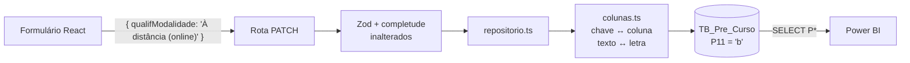

# Respostas por Coluna Design

**Spec**: `.specs/features/respostas-por-coluna/spec.md`
**Status**: Approved (formato aprovado pelo usuário e pelo cliente; o usuário autorizou a implementação em 2026-10-27)

---

## Architecture Overview

A tradução entre o vocabulário do código (`{ chave: valor }` com o texto das opções) e o do banco (colunas `P*` com letras) fica num módulo só: `src/lib/respostas/colunas.ts`. O repositório passa a ler e gravar colunas do próprio registro do formulário, sem tabela lateral. Telas, rotas, Zod, completude e condicionais continuam vendo o mesmo objeto de antes.



A migração faz expand → backfill → conferência → contract num único `migration.sql`. A conferência é uma tabela com um `CHECK` nomeado por formulário: se alguma contagem divergir, o `INSERT` falha com `Check constraint 'respostas_<formulario>_divergentes' is violated` e as tabelas antigas ainda não foram tocadas.

---

## Code Reuse Analysis

### Existing Components to Leverage

| Component | Location | How to Use |
| --- | --- | --- |
| API pública do repositório | `src/lib/respostas/repositorio.ts` | Mantida: `lerRespostas`, `lerRespostasParaApi`, `gravarRespostas`, `apagarRespostas`, `respostasOuNulo`, `ISOLAMENTO_RESPOSTAS`, `AlvoRespostas`. Só a implementação troca. |
| Constantes de opções | `src/lib/validation/schemas/*.schema.ts` (`OPCOES_*`) | Fonte da letra: a posição na lista vira `a`, `b`, `c`… Nenhuma lista duplicada. |
| Merge raso do PATCH | `src/lib/respostas/patch.ts` | Intocado; chama `gravarRespostas` como hoje. |
| Encerramento | `src/lib/respostas/encerramento.ts` | Intocado; `apagarRespostas` passa a gravar `NULL`. |
| Harness de teste de migration | `src/lib/respostas/alteracoes-mtur-migracao.integration.test.ts` (`sqlDaMigration`) | Mesmo padrão: ler o `migration.sql` real e executá-lo comando a comando. |
| `prisma migrate diff --from-schema --to-schema` | CLI do Prisma | Gera a DDL de `ADD COLUMN`/`DROP TABLE` sem banco, garantindo que o `migration.sql` bate com o `schema.prisma`. |

### Integration Points

| System | Integration Method |
| --- | --- |
| Rotas de listagem (`/api/pre-cursos`, `/api/pos-cursos`, `/api/avaliacoes`) | Deixam de usar `include: { linhasResposta }` e `montarRespostas`; passam a pedir as colunas de resposta e separá-las do registro com `separarRespostas`. |
| `src/app/(protegido)/usuarios/page.tsx` | O nome do curso sai de `TB_Pre_Curso.P8` em vez de `RespostaPreCurso` com `chave = 'qualifNomeCurso'`. |
| `scripts/db-test-reset.ts` | Sai a lista das três tabelas `TB_Resposta_*`; `TB_Dado_Pessoal_Aluno` continua. |
| Produção (`deploy/deploy.sh`) | Sem mudança: `migrate deploy` roda a migration; se ela aborta, a versão anterior segue no ar (AD-047). |

---

## Components

### Mapa de colunas

- **Purpose**: Única fonte da correspondência chave → coluna(s) → tipo, e das conversões nos dois sentidos.
- **Location**: `src/lib/respostas/colunas.ts`
- **Interfaces**:
  - `MAPA: Record<Formulario, readonly Entrada[]>`: uma entrada por chave do schema Zod, na ordem do questionário.
  - `colunasDaEntrada(e: Entrada): string[]`: nomes no banco (`P20a`, `P20b`…) de uma entrada.
  - `campoPrisma(coluna: string): string`: `"P25.1"` → `"p25_1"`, `"P10Qual"` → `"p10Qual"`.
  - `paraColunas(f: Formulario, patch: Respostas): Record<string, unknown>`: campos Prisma a gravar; `null` vira `NULL` em todas as colunas da chave.
  - `deColunas(f: Formulario, registro: Record<string, unknown>): Respostas`: o objeto `{ chave: valor }`; chave com todas as colunas `NULL` não aparece.
  - `camposDeResposta(f: Formulario): string[]`: todos os campos Prisma de resposta do formulário (para `select` e `omit`).
- **Dependencies**: os `OPCOES_*` e os quatro schemas Zod.
- **Reuses**: as listas de opções já existentes.

Formato de `Entrada`:

```typescript
type Entrada =
  | { chave: string; tipo: "unica"; coluna: string; opcoes: readonly string[] }
  | { chave: string; tipo: "multipla"; prefixo: string; opcoes: readonly string[] } // colunas = prefixo + letra
  | { chave: string; tipo: "sigla" | "texto" | "inteiro" | "decimal" | "nota" | "data"; coluna: string };
```

Regras de conversão:

| Tipo | Gravar (texto da API → coluna) | Ler (coluna → API) |
| --- | --- | --- |
| `unica` | `opcoes.indexOf(v)` → `a`, `b`… | letra → `opcoes[i]` |
| `multipla` | para cada opção: `true` se marcada, `false` se não | opções com `true`, na ordem do questionário; todas `NULL` → chave ausente |
| `sigla`, `texto` | o próprio texto | o próprio texto |
| `inteiro`, `nota` | o número | o número |
| `decimal` | o número | `Number(decimal)` |
| `data` | `"AAAA-MM-DD"` → `Date` à meia-noite UTC | `Date` → `"AAAA-MM-DD"` |

Um texto que não esteja nas opções é erro de programação (o Zod já o recusa antes) e lança exceção.

### Repositório

- **Purpose**: Ler e gravar respostas como colunas do registro do formulário.
- **Location**: `src/lib/respostas/repositorio.ts`
- **Interfaces**: as mesmas de hoje, mais `separarRespostas(f, registro): { registro; respostas }` para as rotas de listagem. Saem `montarRespostas` e `LINHAS_RESPOSTA_ORDENADAS`.
- **Gravar**: um único `update` (Pré, Pós, Avaliação) ou `upsert` (Dados pessoais, onde a linha pode não existir) com os campos de `paraColunas`. Um comando só por `PATCH`: atômico por construção (COL-30).
- **Ler**: `findUnique` com `select` dos campos de resposta → `deColunas`. Registro inexistente → `{}`.
- **Apagar** (`apagarRespostas`): `update` com `NULL` nas colunas das chaves.
- **Reuses**: `ISOLAMENTO_RESPOSTAS` continua (o deadlock que o motivou vinha do `DELETE` por lacuna de índice; com `UPDATE` por PK ele deixa de existir, mas `READ COMMITTED` segue sem custo e o comentário passa a dizer isso).

### Omissão global das colunas de resposta

- **Purpose**: Impedir que as ~120 colunas `P*` vazem no JSON de qualquer rota que devolva o registro do formulário.
- **Location**: `src/lib/db/prisma.ts`
- **Interfaces**: `new PrismaClient({ adapter, omit: OMITIR_RESPOSTAS })`, com `OMITIR_RESPOSTAS` montado de `camposDeResposta`. O repositório usa `select` explícito, que tem precedência sobre o `omit`.
- **Fallback**: se o tipo do client com `omit` não casar com `Prisma.TransactionClient` no typecheck, a omissão sai do client e cada rota que devolve registro passa a usar `separarRespostas`.

### Migration `respostas_por_coluna`

- **Location**: `prisma/migrations/<timestamp>_respostas_por_coluna/migration.sql`
- **Ordem**:
  1. `ALTER TABLE ... ADD COLUMN` das colunas `P*` em `TB_Pre_Curso`, `TB_Pos_Curso`, `TB_Avaliacao_Aluno` (DDL tirada de `prisma migrate diff`).
  2. `CREATE TABLE TB_Dado_Pessoal_Aluno_Novo` (CPF PK, P3–P9).
  3. Backfill: um `UPDATE ... JOIN (SELECT pai, MAX(CASE ...) ... GROUP BY pai)` por formulário; `INSERT ... SELECT` para os dados pessoais. Texto → letra por `CASE Valor WHEN '<opção>' THEN '<letra>' END` (sem `ELSE`: texto desconhecido vira `NULL` e é pego na conferência). Múltipla: `CASE WHEN SUM(Chave = 'k') > 0 THEN MAX(Chave = 'k' AND Valor = '<opção>') END` → `1`, `0` ou `NULL`. Números e datas por `CAST`; um valor que não converte faz o `UPDATE` falhar no modo estrito, antes de qualquer `DROP`.
  4. Conferência: `CREATE TABLE _Conferencia_Respostas_Por_Coluna` com 8 colunas (esperado/gravado × 4 formulários) e um `CHECK` nomeado por formulário (`respostas_pre_curso_divergentes`, `respostas_pos_curso_divergentes`, `respostas_avaliacao_divergentes`, `respostas_dados_pessoais_divergentes`); um `INSERT` com as contagens. Esperado = linhas antigas de chaves vigentes. Gravado = colunas escalares não nulas + colunas de múltipla com `1`. Medido no MySQL 8.4.11 local: a violação aborta com `ERROR 3819 ... Check constraint 'respostas_pos_curso_divergentes' is violated.`
  5. `DROP TABLE` da conferência, de `TB_Resposta_Pre_Curso`, `TB_Resposta_Pos_Curso`, `TB_Resposta_Avaliacao` e de `TB_Dado_Pessoal_Aluno`; `RENAME` de `TB_Dado_Pessoal_Aluno_Novo` para `TB_Dado_Pessoal_Aluno`; a FK volta com o nome `TB_Dado_Pessoal_Aluno_CPF_fkey`, `ON DELETE CASCADE ON UPDATE CASCADE` (preserva PESSOAL-09 e AD-045).
- **Geração**: o SQL de backfill e de conferência é gerado uma vez por um script descartável (no scratchpad, fora do repositório) a partir de `MAPA`, e revisado. A prova de correção é o teste de integração da migration, não o gerador.
- **Aborto (COL-22)**: tudo até o passo 4 só acrescenta (colunas novas, tabela nova); as tabelas antigas ficam intactas e a versão anterior do app continua funcionando, porque o Prisma seleciona colunas explícitas. O procedimento de reversão vai em `docs/DEPLOY_PRODUCAO.md`.

### Teste da migration

- **Location**: `src/lib/respostas/respostas-por-coluna-migracao.integration.test.ts`
- **Como**: cria um banco descartável (`spma_migracao_colunas`), aplica nele o SQL de todas as migrations anteriores, semeia as tabelas antigas por SQL, roda o `migration.sql` novo e confere as colunas com `SELECT`. Cada cenário recria o banco. O `spma_test` não é tocado.

---

## Data Models

Colunas novas, nulas, na ordem do questionário. Nome no banco → campo Prisma por `campoPrisma`. Tipos: letra `CHAR(1)`, sigla `CHAR(2)`, múltipla `BOOLEAN`, nota `TINYINT`, inteiro `INT`, `DECIMAL(5,2)` para percentual, `DECIMAL(12,2)` para valor em reais, `DATE`, texto livre `TEXT`.

### `TB_Pre_Curso` (63 chaves → 122 colunas)

| Coluna(s) | Chave | Tipo |
| --- | --- | --- |
| P1 | identifUf | sigla |
| P2 | identifMunicipio | texto |
| P3 | identifEntidadeResponsavel | texto |
| P4 | identifCoordenador | texto |
| P5 | identifEmail | texto |
| P6 | identifTelefone | texto |
| P7a | qualifEndereco | texto |
| P7b | qualifMunicipio | texto |
| P7c | qualifUf | sigla |
| P7d | qualifOutrosMunicipios | unica (2) |
| P7e | qualifOutrosMunicipiosQuais | texto |
| P8 | qualifNomeCurso | texto |
| P9 | qualifVinculoPrograma | unica (2) |
| P9Qual | qualifVinculoProgramaQual | texto |
| P10a–P10l | qualifCaracteristicas | multipla (12) |
| P10Qual | qualifCaracteristicasOutra | texto |
| P11 | qualifModalidade | unica (3) |
| P12 | qualifRegiao | unica (4) |
| P13 | planejDataInicioPrevista | data |
| P14 | planejDataTerminoPrevista | data |
| P15 | planejCargaHoraria | inteiro |
| P16 | planejNumTurmas | inteiro |
| P17a | planejNumAlunosPrevistos | inteiro |
| P17b | planejDataInicioInscricao | data |
| P17c | planejDataTerminoInscricao | data |
| P17d | planejNumVagas | inteiro |
| P18 | planejTaxaEvasaoEsperada | decimal (5,2) |
| P19 | planejObjetivo | texto |
| P20a–P20k | publicoPerfil | multipla (11) |
| P21 | publicoInstituicaoExecutora | unica (4) |
| P21.1 | publicoInstituicaoExecutoraNome | texto |
| P22a–P22h | diagnosticoConsultas | multipla (8) |
| P23.1–P23.9 | infraBasicaBanheiros, Bebedouros, Energia, SalaAula, Recepcao, Biblioteca, Mobiliario, Acessibilidade, Laboratorio | nota (0–5) |
| P24.1–P24.8 | infraComplSalaProfessores, SalaGestores, SalaEstudo, Copa, Lanchonete, Auditorio, Audiovisual, Tecnologicos | nota (0–5) |
| P25 | infraEspecificaNecessidade | unica (2) |
| P25.1 | infraEspecificaDisponibilidade | unica (4) |
| P25.2 | infraEspecificaSuficiencia | unica (2) |
| P25.3 | infraEspecificaManutencao | unica (2) |
| P26a–P26h | docenteCriteriosSelecao | multipla (8) |
| P27 | docenteFormaContratacao | unica (3) |
| P27Qual | docenteFormaContratacaoOutra | texto |
| P28 | docenteNivelFormacao | unica (5) |
| P29 | docentePoliticasReparacao | unica (2) |
| P30a–P30i | divulgacaoEstrategias | multipla (9) |
| P30Qual | divulgacaoEstrategiasOutra | texto |
| P31a–P31h | parceriasEstabelecidas | multipla (8) |
| P32a–P32j | suporteEstrategias | multipla (10) |
| P32Qual | suporteEstrategiasOutra | texto |

### `TB_Pos_Curso` (26 chaves → 45 colunas)

| Coluna(s) | Chave | Tipo |
| --- | --- | --- |
| P1 | posAcompanhProblemasEstudo | unica (4) |
| P2 | posAcompanhConceitosTrabalhados | unica (4) |
| P3 | posAcompanhPlanoAcao | unica (4) |
| P4 | posAcompanhProvaSituacao | unica (4) |
| P5 | posAcompanhLicaoIndividual | unica (3) |
| P6a–P6f | posAcompanhMonitoramento | multipla (6) |
| P7 | posExecDataInicioReal | data |
| P8 | posExecDataTerminoReal | data |
| P9 | posExecCargaHorariaRealizada | inteiro |
| P10 | posExecDificuldadesEnfrentadas | texto |
| P11 | posExecHouveAlteracaoPlanejamento | unica (2) |
| P12 | posExecAlteracaoDetalhe | texto |
| P13 | posParticNumInscritos | inteiro |
| P14 | posParticNumMatriculados | inteiro |
| P15 | posParticNumConcluintes | inteiro |
| P16a–P16j | posParticMotivosAbandono | multipla (10) |
| P17 | posParticDemandaMaiorQueOferta | unica (2) |
| P18 | posParticIntencaoNovaOferta | unica (2) |
| P19 | posFinValorTotal | decimal (12,2) |
| P20 | posFinValorProfessores | decimal (12,2) |
| P21 | posFinValorMateriais | decimal (12,2) |
| P22 | posFinValorInfraestrutura | decimal (12,2) |
| P23 | posFinValorBolsaPermanencia | decimal (12,2) |
| P24 | posFinHouveDevolucaoRecursos | unica (2) |
| P25 | posFinNecessidadeAditivo | unica (2) |
| P26a–P26f | posContEstrategias | multipla (6) |

### `TB_Avaliacao_Aluno` (27 chaves → 46 colunas)

| Coluna(s) | Chave | Tipo |
| --- | --- | --- |
| P14 | avalExperienciaTrabalhoPrevio | unica (2) |
| P15 | avalExperienciaCursoAnterior | unica (2) |
| P16 | avalExperienciaTipoCursoAnterior | unica (7) |
| P17a–P17f | avalMotivMotivosParticipacao | multipla (6) |
| P18 | avalMotivFormaConhecimento | unica (8) |
| P19 | avalExpectAtendimento | unica (3) |
| P20 | avalExpectEmprego | unica (3) |
| P21 | avalExpectRenda | unica (4) |
| P22 | avalParticipConcluiuCurso | unica (2) |
| P22.1a–P22.1j | avalParticipMotivoNaoConclusao | multipla (10) |
| P23 | avalParticipPercentualFrequencia | unica (4) |
| P24.1–P24.8 | avalCursoDinamicasInclusao, MaterialDidatico, Conteudo, Clareza, ConhecimentoInstrutores, Organizacao, InfraestruturaBasica, InfraestruturaSalaAula | nota (1–5) |
| P25 | avalAprendizAmpliacaoConhecimento | unica (3) |
| P26 | avalAprendizAtendimentoExpectativas | unica (3) |
| P27 | avalAprendizSensacaoPreparo | unica (3) |
| P29a–P29f | avalMotivacoesPosPercepcoes | multipla (6) |
| P35 | avalGeralNota | nota (0–10) |
| P36 | avalGeralMelhoriasComunidade | texto |
| P37 | avalGeralRecomendaCurso | unica (2) |
| P38 | avalGeralComentariosFinais | texto |

### `TB_Dado_Pessoal_Aluno` (7 chaves → 7 colunas, uma linha por CPF)

| Coluna | Chave | Tipo |
| --- | --- | --- |
| CPF (PK, FK → `TB_Usuario`, cascade) | - | `VARCHAR(14)` |
| P3 | avalPessoalEstado | sigla |
| P4 | avalPessoalMunicipio | texto |
| P5 | avalPessoalGenero | unica (3) |
| P6 | avalPessoalFaixaEtaria | unica (5) |
| P7 | avalPessoalEscolaridade | unica (10) |
| P8 | avalPessoalRacaEtnia | unica (5) |
| P9 | avalPessoalCondicaoPcd | unica (2) |

Conferido contra o papel: a ordem de cada `OPCOES_*` bate com as letras de `docs/Questionario_*.md`, e nenhuma pergunta de múltipla escolha N tem uma pergunta irmã "Na" no mesmo formulário. Por isso `P10a` (opção) nunca colide com uma pergunta `P10a`.

---

## Error Handling Strategy

| Error Scenario | Handling | User Impact |
| --- | --- | --- |
| Texto de opção desconhecido ao gravar | `paraColunas` lança exceção (o Zod já recusa antes, com 400) | Nenhum: inalcançável pela API |
| Letra desconhecida ao ler (ex.: coluna gravada à mão) | `deColunas` devolve a letra crua em vez de esconder o dado | A completude acusa a pergunta como inválida em vez de sumir com ela |
| Migração com contagem divergente ou texto sem opção | `CHECK` nomeado aborta antes de qualquer `DROP` | Deploy para no passo 2; versão anterior segue no ar (AD-047) |
| Migração com número/data que não converte | `UPDATE` falha no modo estrito, antes de qualquer `DROP` | Idem |

---

## Risks & Concerns

| Concern | Location (file:line) | Impact | Mitigation |
| --- | --- | --- | --- |
| Rotas devolvem o registro inteiro do Prisma (`...preCurso`) | `src/app/api/pre-cursos/route.ts:42` e afins | As colunas `P*` vazariam no JSON da API | Omissão global no client; as rotas de listagem usam `separarRespostas` |
| MySQL não reverte DDL em migração que falha | `prisma/migrations/<novo>/migration.sql` | Uma migração abortada deixa colunas novas e a tabela `_Novo` | Tudo antes do `DROP` só acrescenta; reversão documentada em `docs/DEPLOY_PRODUCAO.md` (COL-28) |
| Três testes de integração exercitam migrations antigas sobre as tabelas que esta feature remove | `src/lib/respostas/backfill.integration.test.ts`, `dados-pessoais-migracao.integration.test.ts`, `alteracoes-mtur-migracao.integration.test.ts` | Não têm mais onde rodar | Aposentados: as migrations que provam já foram aplicadas em produção e são imutáveis. O teste novo da migration cobre o caminho atual |
| `agregacao.integration.test.ts` prova RESP-17/18 sobre as tabelas antigas | `src/lib/respostas/agregacao.integration.test.ts` | Perde o objeto | Substituído pelo teste de cruzamento COL-25/26 |
| `forma.ts` só existe para o formato `(Chave, Valor)` | `src/lib/respostas/forma.ts` | Código morto | Removido junto com `forma.test.ts` |
| Valores decimais com mais de 2 casas | `planejTaxaEvasaoEsperada`, `posFin*` (Zod sem limite de casas) | Arredondados para 2 casas ao gravar | Aceito: percentual e reais com 2 casas é a precisão do domínio; registrado em Tech Decisions |
| Linha de `TB_Pre_Curso` com 122 colunas | Limite de linha do InnoDB (~8 KB inline) | Risco de `Row size too large` | Texto livre em `TEXT` (fica fora da linha); o resto são tipos de 1 a 8 bytes. O teste da migration cria a tabela real e prova |

---

## Tech Decisions

| Decision | Choice | Rationale |
| --- | --- | --- |
| Fonte da letra | Posição da opção na lista `OPCOES_*` | Evita uma segunda lista de opções; a conferência contra o papel está registrada acima |
| Nome de campo no Prisma | `campoPrisma(coluna)`: `P` → `p`, `.` → `_` (`p25_1`, `p22_1a`) | O identificador do Prisma não aceita ponto; o `@map` guarda o nome real |
| Coluna com ponto no nome | Aceita pelo Prisma (`@map("P25.1")` gera `` `P25.1` ``), medido com `prisma validate` e `migrate diff` | Pedido do usuário |
| Dados pessoais: tabela nova + rename | `CREATE` da nova, backfill, `DROP` da antiga, `RENAME` | A PK muda de `ID_Dado` para `CPF`; alterar no lugar perderia as linhas antes do backfill |
| Uma migration, não três | Expand, backfill, conferência e contract no mesmo arquivo | A conferência antes do `DROP` dá a mesma segurança que separar em três, e o deploy fica num passo só |
| Decimal com 2 casas | `DECIMAL(5,2)` e `DECIMAL(12,2)` | Precisão do domínio; o Power BI soma sem conversão |

AD nova a registrar em `.specs/STATE.md` (COL-27): **AD-051**, que rescinde a AD-041 e registra a regra de nomes e as duas regras de manutenção.
