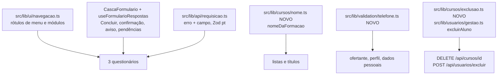

# Revisão de Usabilidade 1 Design

**Spec**: `.specs/features/revisao-usabilidade-1/spec.md`
**Status**: Approved

---

## Architecture Overview

**Abordagem escolhida: renomear só o texto visível.** As alternativas eram (b) renomear também as rotas (`/formacoes`, `/recursos`) com redirect das antigas, ou (c) renomear rotas, tabelas e chaves. (b) e (c) mexem em 41 specs e2e, no proxy, no Power BI (`bi.*`) e, em (c), exigem migration. O cliente pediu nomenclatura para o usuário, e o usuário pediu "sem alterações desnecessárias". Por isso o contrato fica intacto: rotas, `data-testid`, enums, colunas e chaves JSON não mudam.

As mudanças caem em cinco pontos de concentração que já existem. Quase todo item do documento vira edição num deles, não nas telas:

---

## Mapa: item do documento → onde muda

| Doc | O que | Arquivo(s) | Req |
| --- | --- | --- | --- |
| 1 | Painel por extenso | `src/app/(protegido)/painel/page.tsx`, `src/lib/ui/tipos-usuario.ts` (já tem `NOME_TIPO_USUARIO`) | RU-34 |
| 1, com. 1 | Módulos e menu | `src/lib/ui/navegacao.ts` | RU-35, RU-36 |
| com. 2 | Editar Perfil | `src/app/(protegido)/meus-dados/page.tsx`, nova `src/app/api/usuarios/me/perfil/route.ts`, novo `src/components/perfil/PerfilForm.tsx`, `src/components/dados-pessoais/DadosPessoaisForm.tsx`, `src/app/api/usuarios/me/dados-pessoais/route.ts` | RU-47..54 |
| 2 | Telefone/WhatsApp | novo `src/lib/validation/telefone.ts`, `organizacao.schema.ts`, `CadastroOrganizacaoForm.tsx` | RU-43..46 |
| 3 | "Recursos Recebidos" | `src/app/(protegido)/verbas/page.tsx` | RU-37 |
| 4 | "Usuários Cadastrados" | `src/app/(protegido)/usuarios/GestaoUsuarios.tsx:121` | RU-38 |
| 5, nome | Nome obrigatório na criação | `criarCursoSchema` (`pre-curso.schema.ts:6`), `NovoCursoForm.tsx`, `api/cursos/route.ts` (grava `p8` no `preCurso.create`), `qualifNomeCurso` com `.trim()` | RU-57..59 |
| 5 | Seletor de recurso mostra "3" | `src/app/(protegido)/cursos/novo/NovoCursoForm.tsx:92`: o `Select` do Base UI não recebe `items`, então o campo fechado mostra o `value` cru (`node_modules/@base-ui/react/select/root/SelectRoot.d.ts:111`) | RU-15, RU-16 |
| 5 | `#3 ·` na lista de recursos | `src/app/(protegido)/verbas/ListaVerbas.tsx:74` | RU-16 |
| 6, 7 | `Pré-curso #4` nas listas | `pre-cursos/page.tsx:46`, `pos-cursos/page.tsx:48`, `avaliacoes/page.tsx:47` | RU-10, RU-11 |
| 8, 15 | Títulos com código | `PreCursoForm.tsx:489`, `PosCursoForm.tsx:259`, `pos-cursos/[cdCurso]/page.tsx:45` (aviso), `AvaliacaoForm.tsx:411` | RU-12..14 |
| 9 | Datas | `pre-curso.schema.ts:344` (`ordemDatasValida`), `api/pre-cursos/[id]/route.ts:73` | RU-40..42 |
| 10 | Aviso, Concluir, confirmação | `src/components/formulario/CascaFormulario.tsx`, novo `src/components/ui/alert-dialog.tsx` | RU-17..20 |
| 10, obs. | Excluir formação | novo `src/lib/cursos/exclusao.ts`, nova `src/app/api/cursos/[cdCurso]/route.ts`, `PreCursoForm.tsx` | RU-21..27 |
| 11 | Valor previsto | `pos-cursos/[cdCurso]/page.tsx` (já lê o curso), `PosCursoForm.tsx:176` | RU-55, RU-56 |
| 12 | Pendência fantasma | `src/components/formulario/useFormularioRespostas.ts`: `salvarRascunho` limpa `erro` mas nunca `pendentes`; `encerrar` não envia o que está em `alterados`. Correção: bloquear o Concluir enquanto `alterados` não está vazio | RU-01..03 |
| 13, obs. | Excluir aluno | `src/lib/usuarios/gestao.ts`, nova `src/app/api/usuarios/excluir/route.ts`, `LinhaUsuario.tsx` | RU-28..33 |
| 14 | Mensagem em inglês / Parte 1 | `src/lib/api/requisicao.ts:30` devolve `issues[0].message` (padrão do Zod em inglês, sem a pergunta); `AvaliacaoForm.tsx:430` | RU-04..06, RU-09 |
| 15 | Limite de 3 | `avaliacao.schema.ts:182`, `CampoResposta.tsx` (checkbox), `components/formulario/tipos.ts` | RU-07, RU-08 |

---

## Code Reuse Analysis

### Existing Components to Leverage

| Component | Location | How to Use |
| --- | --- | --- |
| `NOME_TIPO_USUARIO` | `src/lib/ui/tipos-usuario.ts` | Nome do perfil por extenso no painel |
| `CascaFormulario` | `src/components/formulario/CascaFormulario.tsx` | Ponto único de Concluir, aviso e confirmação nos 3 questionários |
| `useFormularioRespostas` | `src/components/formulario/useFormularioRespostas.ts` | Ponto único do bug de pendências e do salvar-antes-de-concluir |
| `validado` / `corpoValidado` | `src/lib/api/requisicao.ts` | Acrescenta `campo` ao 400 para todas as rotas de uma vez |
| `erroHttp` | `src/lib/api/erro-http.ts` | Já aceita extras no corpo (ver `saldoDisponivel` em `api/cursos/route.ts:46`) |
| `podeGerenciarPreCurso`, `podeEditarUsuario` | `src/lib/auth/permissoes.ts` | Autoridade das duas exclusões, sem regra nova |
| `buscarUsuarioVisivel` | `src/lib/usuarios/consulta.ts` | Alvo escopado do excluir aluno (404 fora do escopo) |
| `exigirMutacao` | `src/lib/api/guardas.ts` | Sessão + CSRF nas 3 rotas novas |
| `calcularSaldoVerba` | `src/lib/verba/saldo.ts` | Saldo volta sozinho após excluir; o teste de RU-24 usa esta função |
| `dadosCadastraisSchema` | `src/lib/validation/schemas/dados-cadastrais.schema.ts` | Base do `perfilSchema` (nome + e-mail), acrescido de telefone |
| `lerRespostas` | `src/lib/respostas/repositorio.ts` | "Aluno tem resposta?" = algum valor em `lerRespostas` da avaliação |

### Integration Points

| System | Integration Method |
| --- | --- |
| Prisma (omit global de `P*`) | Ler a P8 com `omit: { p8: false }` ou `select: { p8: true }` na relação `curso.preCurso`; nenhuma rota passa a devolver `P*` cru |
| FKs de `TB_Curso` | `ON DELETE CASCADE` em pré e pós (AD-052.3); avaliação sem cascata é o que torna RU-25 também uma garantia física |
| FK `TB_Avaliacao_Aluno` → `TB_Usuario` | Sem cascata: `excluirAluno` apaga as matrículas antes do usuário, na mesma transação |
| Power BI (`bi.*`) | Nenhuma coluna nova ou renomeada; linhas excluídas somem das VIEWs, que é o esperado |

---

## Components

### `nomeDaFormacao`

- **Purpose**: traduzir a P8 no nome exibido.
- **Location**: `src/lib/cursos/nome.ts`
- **Interfaces**: `nomeDaFormacao(p8: string | null | undefined, cdCurso: number): string`
- **Reuses**: nada; função pura.

### Telefone

- **Location**: `src/lib/validation/telefone.ts`
- **Interfaces**: `soDigitosTelefone(v: string): string`, `telefoneValido(v: string): boolean`, `mascaraTelefone(v: string): string`, `telefoneSchema` (Zod, transforma em dígitos), `MENSAGEM_TELEFONE`.

### Confirmação

- **Location**: `src/components/ui/alert-dialog.tsx` (primitivo shadcn sobre `@base-ui/react/alert-dialog`, já instalado) e `src/components/formulario/ConfirmarAcao.tsx` (botão + diálogo Sim/Não, usado em Concluir e nos dois Excluir).
- **Por que não `window.confirm`**: não segue os tokens visuais (AD-039) e não é testável por papel no e2e.

### `excluirCurso`

- **Location**: `src/lib/cursos/exclusao.ts`
- **Interfaces**: `excluirCurso(cdCurso: number, solicitante): Promise<void>`. Lança `erroHttp` 404/403/409.
- **Transação**: lê curso + status do pré + `count` de avaliações dentro de `prisma.$transaction`; `tx.curso.delete` (pré e pós caem por cascata).

### `excluirAluno`

- **Location**: `src/lib/usuarios/gestao.ts` (junto de `atualizarCadastro` e `resetarSenha`)
- **Interfaces**: `excluirAluno(documento: string): Promise<void>`. 409 se houver dado.
- **Transação**: checa `DadoPessoalAluno`, avaliações `ENCERRADO`, e respostas de cada avaliação; apaga `avaliacaoAluno` → `sessao` (já cascata) → `usuario`.

### Rotas novas

| Rota | Guarda | Corpo / Resposta |
| --- | --- | --- |
| `DELETE /api/cursos/[cdCurso]` | `exigirMutacao` + `podeGerenciarPreCurso` | 200 `{ ok: true }`; 403/404/409 |
| `POST /api/usuarios/excluir` (documento no corpo, AD-029/GU-48) | `exigirMutacao` + `exigirAlvoEditavel` | 200; 400 não-aluno; 403 (404 só para AM); 409 |
| `PATCH /api/usuarios/me/perfil` | `exigirMutacao`; AL → 403 | `{ nome, email, telefone? }` → `{ usuario }` |

---

## Error Handling Strategy

| Error Scenario | Handling | User Impact |
| --- | --- | --- |
| Validação Zod de questionário | 400 `{ erro, campo }` | "17. Quais os três (03)...: Selecione no máximo 3 motivos" |
| Concluir com gravação falhando | Não chama `encerrar` | Mensagem da gravação; status segue "Em andamento" |
| Exclusão com filho | 409 com texto do spec, nada apagado | Mensagem no lugar do erro do formulário |
| Exclusão concorrente | Segunda recebe 404 | "Formação não encontrada" |
| Datas fora de ordem | 400 com a regra violada | Mensagem nomeia o par de datas |

---

## Risks & Concerns

| Concern | Location (file:line) | Impact | Mitigation |
| --- | --- | --- | --- |
| e2e acoplados a texto ("Encerrar", "Pré-curso #", rótulos do menu) | `e2e/*-formulario.spec.ts`, `e2e/identidade-visual.spec.ts:260`, `e2e/pre-cursos-page.spec.ts:86` | Renomear quebra ~50 asserções | Cada task de texto atualiza as asserções no mesmo commit; `data-testid` intocado, então só os seletores por texto mudam |
| `z.config(pt)` muda toda mensagem padrão | schemas em `src/lib/validation/schemas/` | Testes que comparam mensagem padrão em inglês | Levantar com `grep` antes; as mensagens customizadas (maioria) não mudam |
| Regra nova de inscrição em pré-curso antigo | `api/pre-cursos/[id]/route.ts:73` (valida o estado mesclado) | Um cadastro em andamento com 17b ≥ 13 travaria qualquer gravação | Decisão do usuário: as datas só são conferidas quando o `PATCH` traz uma delas, e na conclusão (RU-61, RU-62). O cadastro antigo grava as outras perguntas e só não conclui com as datas erradas |
| Exclusão definitiva de dado do cliente | rotas novas | Perda irreversível | Confirmação dupla na tela + regra de filho checada dentro da transação + FK sem cascata na avaliação |
| Telefone em `Tel_Organizacao` para pessoa física | `prisma/schema.prisma` (`telefone`) | Nome de coluna enganoso | Comentário no schema; renomear fica em Deferred Ideas |

---

## Tech Decisions

| Decision | Choice | Rationale |
| --- | --- | --- |
| Escopo das renomeações | Só texto visível | Ver Architecture Overview; vira AD-054 |
| Mensagens de validação | `campo` no 400 + rótulo resolvido no cliente | O servidor não conhece os rótulos; o cliente já tem `rotuloDaChave` (`CascaFormulario`) |
| Zod em português | `z.config(z.locales.pt())` num módulo importado pelos schemas | Cobre mensagens padrão restantes sem tocar em cada campo |
| Nome da formação | Função única `nomeDaFormacao` | Mesma regra nas 3 listas e 4 títulos |
| Limite de seleção | `maxSelecoes` no `CampoDef` genérico | Vale para qualquer múltipla com teto, sem caso especial na tela da avaliação |

> AD-054 (a registrar em T31): nomenclatura do cliente só na camada visível; exclusões de formação e de aluno com regra de "filho"; telefone de todos os perfis em `Usuario.telefone`.
