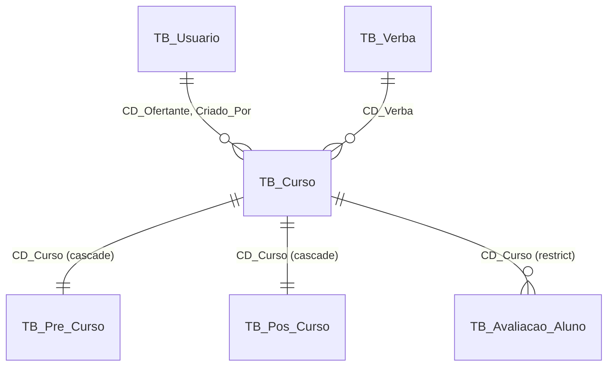

# Tabela de Curso Design

**Spec**: `.specs/features/tabela-curso/spec.md`
**Status**: Approved

---

## Architecture Overview

O curso vira um model próprio, `Curso` (`TB_Curso`), dono do código gerado e dos dados que valem para o curso inteiro. `PreCurso`, `PosCurso` e `AvaliacaoAluno` passam a ter a relação `curso` sobre o mesmo `CD_Curso`. As rotas continuam devolvendo o mesmo JSON: uma função única achata os campos do curso no registro da etapa.



Fluxo de criação (`POST /api/cursos`), numa transação: `curso.create` → `preCurso.create({ cdCurso })` → `posCurso.create({ cdCurso })`.

O nome do curso continua sendo só a P8 de `TB_Pre_Curso`; `TB_Curso` não tem nome.

---

## Code Reuse Analysis

| Existente | Uso |
| --- | --- |
| Relação `AvaliacaoAluno.curso` (hoje para `PreCurso`) | Mantém o nome e passa a apontar para `Curso`: `where: { curso: { cdOfertante } }` e `include: { curso: { select: { cdOfertante: true } } }` não mudam. |
| `whereDeEscopo` (`src/lib/api/escopo.ts`) | Os ramos de pré e pós passam a filtrar por `{ curso: { cdOfertante } }`. |
| Harness da migration por `prisma migrate deploy` em banco descartável (`respostas-por-coluna-migracao.integration.test.ts`) | Copiado para o teste da migration nova. |
| Autoconferência por tabela com `CHECK` nomeado (AD-051) | Mesmo padrão: o MySQL aborta com o nome da conferência. |
| `scripts/views-bi.sql` + `views-bi.ts` | Ganha `bi.TB_Curso`; pré e pós perdem as colunas movidas. |
| `scripts/e2e-fixture.ts` | `criarPreCurso` cria curso + pré com a mesma assinatura; `getPreCurso`/`getPosCurso` achatam o curso. Os specs e2e não mudam. |

---

## Components

### `src/lib/cursos/curso.ts` (novo)

- `INCLUIR_CURSO`: `{ curso: { select: { cdOfertante, cdVerba, vlCursoAlocado, criadoPor, dataCriacao } } }`.
- `comCurso(registro)`: devolve o registro sem a chave `curso` e com os campos dela no topo. É a única tradução entre o modelo novo e o JSON de sempre (CUR-11).
- O pós-curso só expõe `criadoPor`, `dataCriacao` e `cdOfertante`, os campos que já expunha: `comCurso` recebe a lista de campos a achatar.

### Rotas e páginas

Trocam `preCurso.cdOfertante` por `preCurso.curso.cdOfertante` (ou `comCurso`) e `posCurso.preCurso.cdOfertante` por `posCurso.curso.cdOfertante`. O pós lê o status do pré por `curso.preCurso.status`. Sem mudança de guard ou de resposta.

### `src/lib/verba/saldo.ts`

A soma do alocado passa de `preCurso.aggregate` para `curso.aggregate` (CUR-12).

### Migration `…_tabela_curso`

1. **Expand:** `CREATE TABLE TB_Curso`.
2. **Backfill:** `INSERT INTO TB_Curso SELECT CD_Curso, CD_Ofertante, CD_Verba, VL_Curso_Alocado, Criado_Por, Data_Criacao FROM TB_Pre_Curso`. O `AUTO_INCREMENT` do InnoDB avança sozinho para depois do maior `CD_Curso` inserido (CUR-15).
3. **Conferência:** tabela `_Conferencia_Tabela_Curso` com dois `CHECK` nomeados.
   - `cursos_divergentes`: mesma contagem, e nenhuma linha em que algum campo do curso difira do pré de origem (comparação com `<=>`). Cobre CUR-16.
   - `cursos_orfaos`: nenhum pós ou avaliação sem curso. Cobre CUR-17.
4. **Contract:**
   - tira as FKs antigas;
   - tira o `AUTO_INCREMENT` de `TB_Pre_Curso.CD_Curso`;
   - remove as colunas movidas;
   - cria as FKs novas.

   O DDL deste passo sai do `prisma migrate diff` contra o schema novo, como na AD-051.

### `src/lib/respostas/views-bi.ts`

Entrada nova `TB_Curso` (sem formulário); colunas fixas de pré e pós atualizadas.

---

## Data Models

```prisma
model Curso {
  cdCurso        Int      @id @default(autoincrement()) @map("CD_Curso")
  cdOfertante    String   @map("CD_Ofertante") @db.VarChar(14)
  cdVerba        Int      @map("CD_Verba")
  vlCursoAlocado Decimal  @map("VL_Curso_Alocado") @db.Decimal(10, 2)
  criadoPor      String   @map("Criado_Por") @db.VarChar(14)
  dataCriacao    DateTime @default(now()) @map("Data_Criacao")

  ofertante  Usuario          @relation("CursoOfertante", ...)
  verba      Verba            @relation(...)
  criador    Usuario          @relation("CursoCriador", ...)
  preCurso   PreCurso?
  posCurso   PosCurso?
  avaliacoes AvaliacaoAluno[]

  @@index([cdOfertante])
  @@index([cdVerba])
  @@map("TB_Curso")
}
```

- `PreCurso.cdCurso`: `@id` sem `@default`, com `curso Curso @relation(onDelete: Cascade)`.
- `PosCurso.cdCurso`: `curso Curso @relation(onDelete: Cascade)` no lugar de `preCurso`.
- `AvaliacaoAluno.curso`: passa a ser `Curso`, sem `onDelete`, ou seja, Restrict, como hoje (CUR-08).

---

## Error Handling Strategy

| Falha | Tratamento |
| --- | --- |
| Erro no meio da criação de curso | Transação desfaz curso, pré e pós (CUR-06). |
| Conferência da migration não bate | `CHECK` nomeado aborta antes do contract; as colunas antigas seguem intactas (CUR-16, CUR-17). Reversão documentada (CUR-23). |
| VIEWs do `bi` apontando para colunas removidas | Aplicar `views-bi.sql` logo depois do deploy (CUR-21, CUR-23). |

---

## Risks & Concerns

- **DDL do MySQL não é transacional.** Tudo antes do contract só acrescenta, como na AD-051; uma reversão (`reversao.sql`) desfaz uma tentativa abortada.
- **Raio de mudança grande** (cerca de 20 arquivos de `src`). Mitigação: `comCurso` concentra a tradução, e a suíte existente não muda (CUR-13).
- **Power BI.** Relatórios que usam ofertante, verba ou valor de `bi.TB_Pre_Curso` precisam passar a usá-los de `bi.TB_Curso`. Isso é aceito pelo usuário e vai registrado no guia.

---

## Tech Decisions

| Decisão | Escolha | Motivo |
| --- | --- | --- |
| Nome do model | `Curso`, relação `curso` em pré, pós e avaliação | A avaliação já usa `curso`: os filtros dela não mudam. |
| Contrato HTTP | Achatar com `comCurso` | Nenhuma tela nem e2e muda (CUR-11, CUR-13). |
| Nome do curso | Fica na P8 do pré-curso | Decisão do usuário. |
